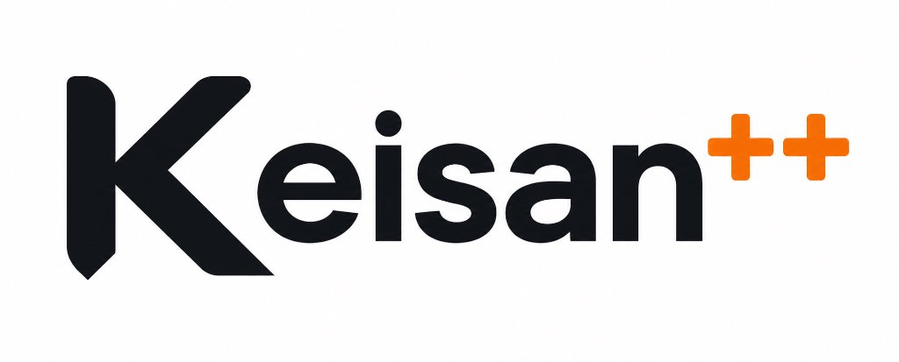
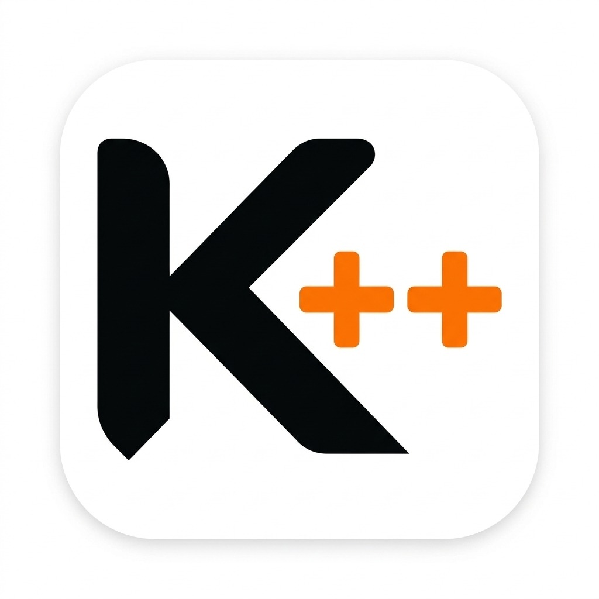
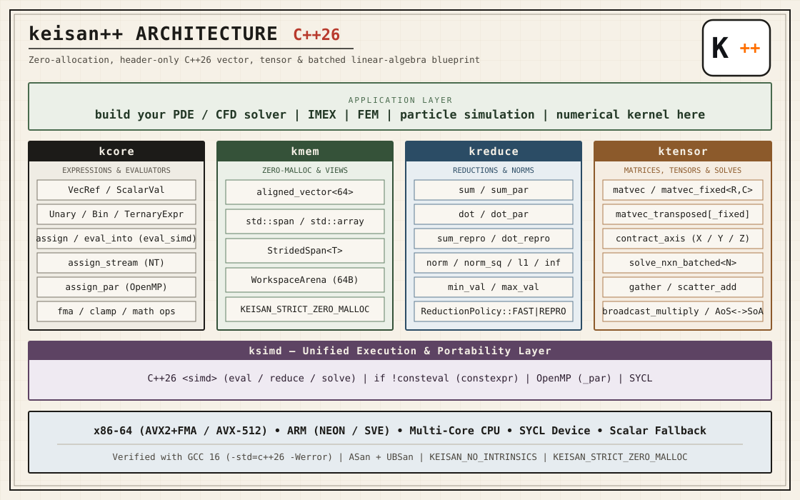

<p align="center">
  
</p>

<h1 align="center"><code>keisan++</code> (<code>keisan</code>)</h1>

<p align="center">
  &nbsp;
  <a href="https://github.com/maithreyanprabhu2907-prog/keisanpp/actions/workflows/ci.yml"></a>
</p>

**A zero-allocation, header-only C++26 vector & Discontinuous Galerkin (DG) math library** powered by portable `std::simd`, OpenMP, and SYCL-compatible expression templates.



---

## 30-Second Quickstart (C++26 / GCC 16+)

`keisan++` is a single header: [include/keisan/keisan.hpp](include/keisan/keisan.hpp).

```cpp
#include <keisan/keisan.hpp>
#include <iostream>

int main() {
    using namespace keisan::ops;

    keisan::aligned_vector<double> u(1024, 1.0), f(1024, 2.0), out(1024);
    keisan::assign(out, keisan::fma(0.5, f, u)); // single fused SIMD loop, 0 allocations

    double energy = keisan::dot(out, out);         // portable std::simd FMA reduction
    double repro  = keisan::sum_repro(out);        // bit-identical pairwise tree sum
    std::cout << "energy=" << energy << " repro=" << repro << "\n";
}
```

### Build & Test with CMake + CTest
```bash
cmake -B build -DCMAKE_BUILD_TYPE=Release -DKEISAN_BUILD_EXAMPLES=ON -DKEISAN_BUILD_BENCHMARKS=ON
cmake --build build -j
ctest --test-dir build --output-on-failure
./build/01_fused_expressions
./build/regression_bench --quick
```

> **Compiler requirement**: C++26 with `<simd>` (GCC 16+ recommended). Pass `-DKEISAN_NO_INTRINSICS` to compile pure portable scalar loops without `<simd>`. CI builds and runs CTest on all configurations, and builds and runs all five `examples/` (`01_fused_expressions`..`05_repro_openmp`) on Release builds.

---

## Documentation Map

| Document | What it covers |
|---|---|
| **[API Cheatsheet](docs/cheatsheet.md)** | 1-page, color-grouped reference of every public function, type, concept, and macro |
| **[Detailed API & Design Reference](docs/api_reference.md)** | Per-public-function reference + architectural rationale, complexity, and invariants |
| **[Architectural Design Guide](docs/architecture.md)** | Deep dive into the 4-layer design, `VecRef` / `std::simd` lowering, aliasing, and zero-malloc patterns |
| **[Benchmarks & Roofline](docs/benchmarks.md)** | `regression_bench` methodology and measured GCC 16 AVX2+FMA throughput numbers |
| **[Runnable Examples](examples/)** | Self-contained 30-line programs covering expressions, `WorkspaceArena`, sum-factorization, `solve_nxn_batched`, and `REPRO` reductions |

---

## Repository Layout

```text
include/keisan/keisan.hpp          Single-header C++26 library
examples/                          Runnable micro-examples (01..05)
tests/                             CTest suite (vector_math_test, audit_math, edge_cases_test, no_intrinsics_test)
benchmarks/                        regression_bench, benchmark, opt_compare
docs/                              architecture.svg, cheatsheet.md, api_reference.md, architecture.md, benchmarks.md
CMakeLists.txt                     C++26 build, CTest targets, and install/export rules
```
