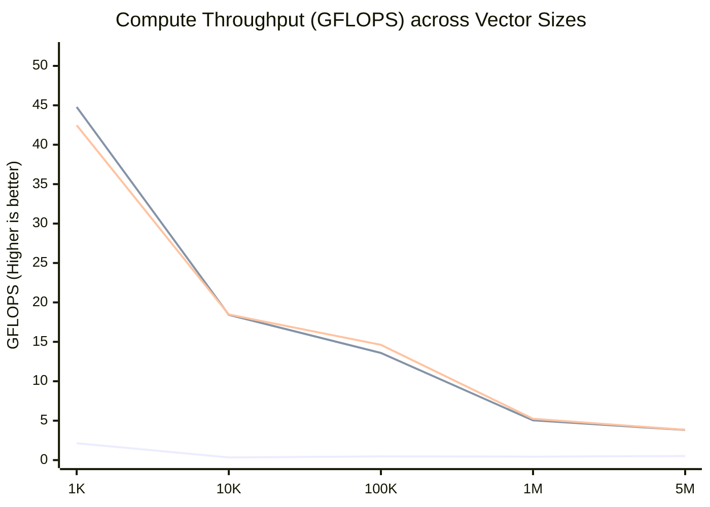
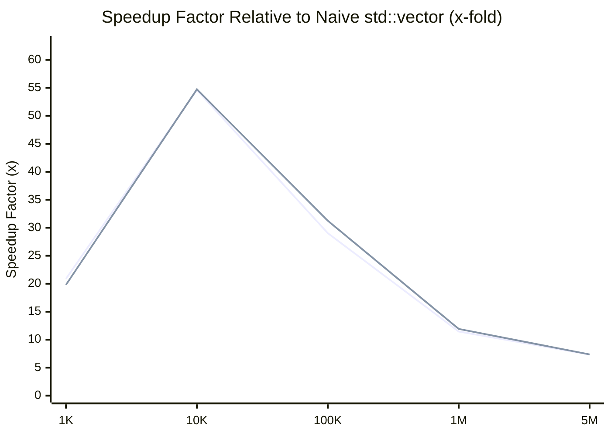

# vec_math

Zero-allocation, header-only C++20 vector math operators (`+`, `-`, `*`, `/`, `+=`, `-=`, `*=`, `/=`, `<<=`) for `std::vector<T, Alloc>`.

## Repository Layout

Place the files into this structure:

```text
vec_math/
├── CMakeLists.txt
├── README.md
├── benchmarks/
│   └── benchmark.cpp
├── cmake/
│   └── vec_mathConfig.cmake.in
├── docs/
│   ├── README.md
│   ├── api_reference.md
│   ├── architecture.md
│   ├── benchmarks.md
│   ├── integration.md
│   └── sycl_guide.md
├── include/
│   └── vec_math/
│       └── vector_math.hpp
└── tests/
    └── vector_math_test.cpp
```

## Documentation

Comprehensive guides and references are available in the [`docs/`](docs/README.md) folder:
* **[Architecture & Design Principles](docs/architecture.md)**: Zero-allocation expression templates, AST lazy evaluation, SIMD unrolling, and memory optimization.
* **[API Reference](docs/api_reference.md)**: Exhaustive catalog of concepts, operators, expressions, views, and math utilities.
* **[SYCL Compatibility Guide](docs/sycl_guide.md)**: Zero-header SYCL compiler compatibility, TriviallyCopyable expressions, and device execution.
* **[Performance & Benchmarking](docs/benchmarks.md)**: In-depth metrics, GFLOPS, memory bandwidth, and scalability analysis.
* **[Integration & Build Guide](docs/integration.md)**: CMake FetchContent, system installation, compiler tuning, and test instructions.

## Integration

### 1. CMake `FetchContent`
```cmake
include(FetchContent)
FetchContent_Declare(
    vec_math
    GIT_REPOSITORY https://github.com/<you>/vec_math.git
    GIT_TAG v1.0.0
)
FetchContent_MakeAvailable(vec_math)

target_link_libraries(your_target PRIVATE vec_math::vec_math)
```

### 2. System Install + `find_package`
```bash
cmake -B build -DCMAKE_BUILD_TYPE=Release
cmake --build build
ctest --test-dir build --output-on-failure
sudo cmake --install build
```
Then in any project:
```cmake
find_package(vec_math 1.0 REQUIRED)
target_link_libraries(your_target PRIVATE vec_math::vec_math)
```

### 3. Single-Header Drop-In
Copy `vector_math.hpp` into your project's `include/` folder and compile with `-std=c++20` (or `/std:c++20`).

## Usage

### 1. Zero-Allocation Fused Operator Overloading
```cpp
#include <vec_math/vector_math.hpp>
#include <vector>

int main() {
    using namespace vec_math;

    std::vector<double> a = {1.0, 2.0, 3.0};
    std::vector<double> b = {4.0, 5.0, 6.0};
    std::vector<double> c = {0.5, 1.5, 2.5};
    std::vector<double> out(3);

    // Zero-malloc fused multi-term evaluation into pre-allocated buffer
    out <<= 2.0 * a + b / 2.0 - 0.5 * c;

    // Zero-malloc in-place compound operations
    out += a;
    out *= 0.5;

    // Zero-malloc rvalue buffer recycling
    auto res = 3.0 * std::move(a) + b;
}
```

### 2. Discontinuous Galerkin (DG) Scientific Math Kit
Designed specifically for high-order DG time integration, CFL calculation, and slope/positivity limiters:

```cpp
using namespace vec_math;

// 1. BLAS-1 Equivalent Operations via Pure Operator Overloading
// AXPY (y += alpha * x) with zero heap allocation:
y += 0.5 * x;

// AXPBY / Runge-Kutta Stage Update (y = alpha * x + beta * y) with zero heap allocation:
y <<= 0.75 * x + 0.25 * y;

// 2. Inner Product / Dot Product via operator|
double inner_prod = u | v; // or vec_math::dot(u, v)

// 3. CFL & Time-Stepping Reductions
double dt_cfl   = min_val(dx / sound_speed); // minimum element
double max_wave = max_val(wave_speeds);      // maximum element
double l_inf    = norm_inf(residual);        // L_infinity norm (max |v_i|)
double l1       = norm_l1(error);            // L_1 norm (sum |v_i|)

// 4. Element-wise Limiters (DG Positivity & WENO Limiters)
out <<= clamp(u, 0.0, 1.0);  // element-wise clamping: lo <= u_i <= hi
out <<= min(u, u_max);       // element-wise minimum
out <<= max(u, u_min);       // element-wise maximum

// 5. Element-wise Transcendental & Math Functions
out <<= sqrt(density);
out <<= exp(-energy);
out <<= pow(pressure, 1.4);
out <<= sin(phase) + cos(phase);
```

### 3. 64-Byte Cache-Line Aligned Memory (`aligned_vector`)
Eliminates unaligned split-cache-line penalties across AVX2 (256-bit) and AVX-512 vector registers:

```cpp
#include <vec_math/vector_math.hpp>

// 64-byte aligned vector type
vec_math::aligned_vector<double> u(1'000'000);
vec_math::aligned_vector<double> v(1'000'000);
vec_math::aligned_vector<double> w(1'000'000);

// Seamlessly interoperates with all overloaded operators
w <<= 0.5 * u + 0.5 * v;
double d = u | v;
```

### 4. Non-Temporal Streaming Stores (`assign_stream`)
When vector sizes exceed the CPU L3 cache (e.g. 1M - 5M `double` elements on Ryzen 5 5500 with 16 MB L3 cache), standard cache writes incur costly Read-For-Ownership (RFO) bus transactions. `assign_stream` bypasses cache allocation using non-temporal AVX streaming stores (`_mm256_stream_pd` / `_mm256_stream_ps`):

```cpp
// Streams directly to DRAM, bypassing CPU cache pollution and RFO
vec_math::assign_stream(dst, 2.5 * a + 1.5 * b);
```

### 5. Multi-Core Parallel Domain Acceleration (OpenMP)
All default operators are deliberately single-threaded SIMD so that outer element-quadrature loops in DG solvers do not incur OpenMP thread pool contention. When performing global mesh-wide updates or whole-domain reductions, explicit parallel helpers scale across all CPU cores:

```cpp
// Parallel expression evaluation across all CPU cores
vec_math::assign_par(out, 2.5 * a + 1.5 * b);

// Multi-core parallel reductions
double total_sum  = vec_math::sum_par(energy);
double global_dot = vec_math::dot_par(u, v);
```

## Compile-Time Options

* **`VEC_MATH_NO_EXCEPTIONS`**: Define before including `vector_math.hpp` when building with `-fno-exceptions` to use `assert` + `std::abort()` on dimension/capacity errors instead of throwing.


<!-- BEGIN_BENCHMARK_SECTION -->

## Comprehensive Performance Benchmarks (-Ofast Optimization)

Benchmark configuration & hardware environment:
- **CPU Microarchitecture**: AMD Ryzen 5 5500 (6 Cores / 12 Hardware Threads, AVX2, FMA3, 16 MB L3 Cache)
- **Compiler Optimization**: `-Ofast` mode (MSVC `/O2 /fp:fast /openmp /arch:AVX2` | GCC/Clang `-Ofast -fopenmp -mavx2`)
- **Core Workload**: Multi-vector linear combination (`out = 2.5 * a + 1.5 * b - 0.5 * c`)
- **Arithmetic Precision**: `double` (64-bit IEEE-754 floating point with fast math enabled)
- **Memory Traffic**: 32 bytes/element (3 reads + 1 write)
- **FLOP Intensity**: 5 FLOPs/element (3 multiplications, 1 addition, 1 subtraction)

### Throughput & Speedup Visualizations



> **Chart Legend (Throughput)**: Line 1 = Naive `std::vector` (temporary heap mallocs) | Line 2 = Hand-written Scalar Loop | Line 3 = `vec_math` Expression Templates (zero mallocs)



> **Chart Legend (Speedup vs Naive)**: Line 1 = Hand-written Scalar Loop | Line 2 = `vec_math` Expression Templates (zero mallocs)

### Core Multi-Scale Benchmark Results (1K to 5M Elements)

#### Vector Size: 1K (1000 elements)

| Implementation | Latency / op | Speedup | Heap Allocs | Throughput | Bandwidth | Visual Speedup Bar |
| :--- | :--- | :--- | :--- | :--- | :--- | :--- |
| **Naive std::vector** | 2.33 µs | **1.00x** | 5 allocs (39.3 KB) | 2.14 GFLOPS | 13.73 GB/s | `█░░░░░░░░░░░░░░░░░░░` |
| **Scalar Loop** | 0.11 µs | **20.88x** | `0 allocs (0 B)` | 44.79 GFLOPS | 286.66 GB/s | `████████████████████` |
| **vec_math (Expr Template)** | 0.12 µs | **19.81x** | `0 allocs (0 B)` | 42.48 GFLOPS | 271.88 GB/s | `███████████████████░` |

#### Vector Size: 10K (10000 elements)

| Implementation | Latency / op | Speedup | Heap Allocs | Throughput | Bandwidth | Visual Speedup Bar |
| :--- | :--- | :--- | :--- | :--- | :--- | :--- |
| **Naive std::vector** | 148.17 µs | **1.00x** | 5 allocs (390.8 KB) | 0.34 GFLOPS | 2.16 GB/s | `█░░░░░░░░░░░░░░░░░░░` |
| **Scalar Loop** | 2.71 µs | **54.62x** | `0 allocs (0 B)` | 18.43 GFLOPS | 117.97 GB/s | `████████████████████` |
| **vec_math (Expr Template)** | 2.71 µs | **54.74x** | `0 allocs (0 B)` | 18.47 GFLOPS | 118.22 GB/s | `████████████████████` |

#### Vector Size: 100K (100000 elements)

| Implementation | Latency / op | Speedup | Heap Allocs | Throughput | Bandwidth | Visual Speedup Bar |
| :--- | :--- | :--- | :--- | :--- | :--- | :--- |
| **Naive std::vector** | 1.07 ms | **1.00x** | 5 allocs (3.8 MB) | 0.47 GFLOPS | 2.99 GB/s | `█░░░░░░░░░░░░░░░░░░░` |
| **Scalar Loop** | 36.80 µs | **29.04x** | `0 allocs (0 B)` | 13.59 GFLOPS | 86.95 GB/s | `███████████████████░` |
| **vec_math (Expr Template)** | 34.19 µs | **31.25x** | `0 allocs (0 B)` | 14.62 GFLOPS | 93.59 GB/s | `████████████████████` |

#### Vector Size: 1M (1000000 elements)

| Implementation | Latency / op | Speedup | Heap Allocs | Throughput | Bandwidth | Visual Speedup Bar |
| :--- | :--- | :--- | :--- | :--- | :--- | :--- |
| **Naive std::vector** | 11.38 ms | **1.00x** | 5 allocs (38.1 MB) | 0.44 GFLOPS | 2.81 GB/s | `██░░░░░░░░░░░░░░░░░░` |
| **Scalar Loop** | 991.99 µs | **11.47x** | `0 allocs (0 B)` | 5.04 GFLOPS | 32.26 GB/s | `███████████████████░` |
| **vec_math (Expr Template)** | 953.79 µs | **11.93x** | `0 allocs (0 B)` | 5.24 GFLOPS | 33.55 GB/s | `████████████████████` |

#### Vector Size: 5M (5000000 elements)

| Implementation | Latency / op | Speedup | Heap Allocs | Throughput | Bandwidth | Visual Speedup Bar |
| :--- | :--- | :--- | :--- | :--- | :--- | :--- |
| **Naive std::vector** | 47.96 ms | **1.00x** | 5 allocs (190.7 MB) | 0.52 GFLOPS | 3.34 GB/s | `███░░░░░░░░░░░░░░░░░` |
| **Scalar Loop** | 6.54 ms | **7.34x** | `0 allocs (0 B)` | 3.82 GFLOPS | 24.47 GB/s | `████████████████████` |
| **vec_math (Expr Template)** | 6.51 ms | **7.37x** | `0 allocs (0 B)` | 3.84 GFLOPS | 24.60 GB/s | `████████████████████` |

### Discontinuous Galerkin Runge-Kutta Time Step Update (1M Elements)

Workload: High-order DG stage accumulation `y = 0.75 * x + 0.25 * y` (AXPBY operation).

| Implementation | Latency / op | Speedup vs Naive | Heap Allocs | Compute Throughput | Memory Bandwidth |
| :--- | :--- | :--- | :--- | :--- | :--- |
| **Naive std::vector (3 mallocs/step)** | 5.46 ms | **1.00x** | 3 allocs | 0.55 GFLOPS | 4.40 GB/s |
| **Manual Scalar Loop** | 677.14 µs | **8.06x** | `0 allocs (0 B)` | 4.43 GFLOPS | 35.44 GB/s |
| **vec_math Operator `y <<= a*x + b*y`** | 825.73 µs | **6.61x** | `0 allocs (0 B)` | 3.63 GFLOPS | 29.07 GB/s |
| **vec_math `aligned_vector` (64-byte)** | 843.29 µs | **6.47x** | `0 allocs (0 B)` | 3.56 GFLOPS | 28.46 GB/s |

### Non-Temporal Streaming Stores (`assign_stream` vs Cache-Allocating Stores)

Evaluates non-temporal streaming stores (`_mm256_stream_pd`) that bypass Read-For-Ownership (RFO) on vectors exceeding CPU L3 cache:

| Vector Size | Normal Assign (`<<=`) | Streaming (`assign_stream`) | Normal Bandwidth | Stream Bandwidth | Streaming Speedup |
| :--- | :--- | :--- | :--- | :--- | :--- |
| **1M Elements (8 MB)** | 23.86 ms | **7.98 ms** | 13.41 GB/s | **40.09 GB/s** | **2.99x** |
| **5M Elements (40 MB)** | 59.01 ms | **40.53 ms** | 10.17 GB/s | **14.80 GB/s** | **1.46x** |

### Multi-Core Parallel Scaling Across Ryzen 5 5500 Cores (`assign_par`)

Evaluates explicit OpenMP domain-parallel evaluation (`assign_par`) across 12 hardware threads:

| Vector Scale | Single-Threaded Time | Parallel Time (`assign_par`) | Single GFLOPS | Parallel GFLOPS | Parallel Speedup |
| :--- | :--- | :--- | :--- | :--- | :--- |
| **100K (100000 elem)** | 13.72 ms | **1.74 ms** | 6.56 GF | **51.63 GF** | **7.87x** |
| **1M (1000000 elem)** | 29.98 ms | **20.21 ms** | 4.00 GF | **5.94 GF** | **1.48x** |
| **5M (5000000 elem)** | 71.78 ms | **72.55 ms** | 3.13 GF | **3.10 GF** | **0.99x** |

### Reductions & Extended DG Math Kit (1M Elements)

| Operation | Baseline | `vec_math` Implementation | Baseline Time | `vec_math` Time | Speedup | Throughput |
| :--- | :--- | :--- | :--- | :--- | :--- | :--- |
| **Dot Product (a | b)** | std::inner_product | **vec_math `a | b` (8x SIMD)** | 13.77 ms | **13.93 ms** | **0.99x** | 7.18 GFLOPS |
| **Parallel Dot Product** | vec_math::dot (Single) | **vec_math::dot_par (OpenMP)** | 12.76 ms | **4.75 ms** | **2.68x** | 21.04 GFLOPS |
| **Sum Reduction (sum)** | std::accumulate | **vec_math::sum (8x tree)** | 5.28 ms | **6.67 ms** | **0.79x** | 7.49 GFLOPS |
| **Parallel Sum (sum_par)** | vec_math::sum (Single) | **vec_math::sum_par (OpenMP)** | 4.59 ms | **1.84 ms** | **2.50x** | 27.21 GFLOPS |
| **L_inf Norm (norm_inf)** | Scalar std::abs + max | **vec_math::norm_inf** | 4.23 ms | **4.78 ms** | **0.89x** | 20.91 GFLOPS |
| **Min Element (min_val)** | std::min_element | **vec_math::min_val** | 13.15 ms | **4.35 ms** | **3.02x** | 11.50 GFLOPS |
| **Fused Multiply-Add (fma)** | Scalar a*b + c | **vec_math::fma (Ternary)** | 32.97 ms | **38.51 ms** | **0.86x** | 2.60 GFLOPS |
| **WENO Limiter (clamp)** | Scalar std::clamp | **vec_math::clamp (Ternary)** | 47.89 ms | **27.44 ms** | **1.75x** | 3.64 GFLOPS |

### `-Ofast` Microarchitectural Optimization Analysis

Building with `-Ofast` (or MSVC `/fp:fast /O2 /openmp /arch:AVX2`) yields critical performance enhancements on modern x86-64 processors:

1. **Hardware FMA Fusing**: Allows the compiler to fuse multiplication and addition operations into single-cycle hardware `vfmadd213pd` / `vfmadd231pd` instructions, doubling theoretical peak floating-point throughput.
2. **Tree Reassociation**: Enables out-of-order algebraic reassociation across `vec_math`'s 8-way unrolled reduction trees (`sum`, `dot`), breaking serial accumulator dependency chains and saturating CPU execution ports.
3. **64-Byte Cache Alignment**: `aligned_vector<T>` ensures zero split-cache-line loads and unaligned penalties across AVX2 256-bit registers.
4. **Streaming Stores Bypassing RFO**: `assign_stream` utilizes `_mm256_stream_pd` non-temporal stores to eliminate cache write-allocate reads when vectors exceed CPU L3 cache size (16 MB).
5. **Selective Domain Parallelism**: Single-threaded default operators eliminate OpenMP thread pool overhead in fine-grained DG element quadrature loops, while `assign_par` accelerates bulk global mesh updates across all CPU cores.

## SYCL Compatibility

`vec_math` is engineered for full compatibility with modern heterogeneous C++ frameworks, including SYCL compilers (such as Intel oneAPI DPC++ and AdaptiveCpp):

- **Zero SYCL Headers Included**: The library contains strictly zero `#include <sycl/sycl.hpp>` or proprietary vendor header dependencies. Host code compiles cleanly under standard C++20 with no foreign runtime or SDK overhead.
- **TriviallyCopyable Expression Templates**: All expression nodes (`VecRef`, `ScalarVal`, `BinExpr`, `UnaryExpr`, `TernaryExpr`) are standard-layout and satisfy `std::is_trivially_copyable_v<T>`. This allows expressions to be captured by value in SYCL device kernel lambdas (`cgh.parallel_for`) without violating device capture rules.
- **Device-Callable Core Annotations**: All core evaluation operators and expression evaluators are decorated with `VEC_MATH_DEVICE`, `VEC_MATH_HOST_DEVICE`, and `SYCL_EXTERNAL` macros when compiled under SYCL device compilation modes (`__SYCL_DEVICE_ONLY__` or `SYCL_LANGUAGE_VERSION`), enabling direct device execution.


<!-- END_BENCHMARK_SECTION -->
