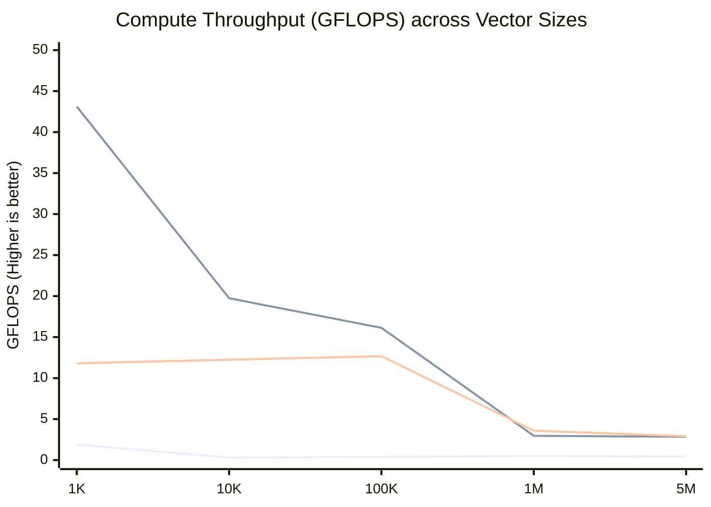
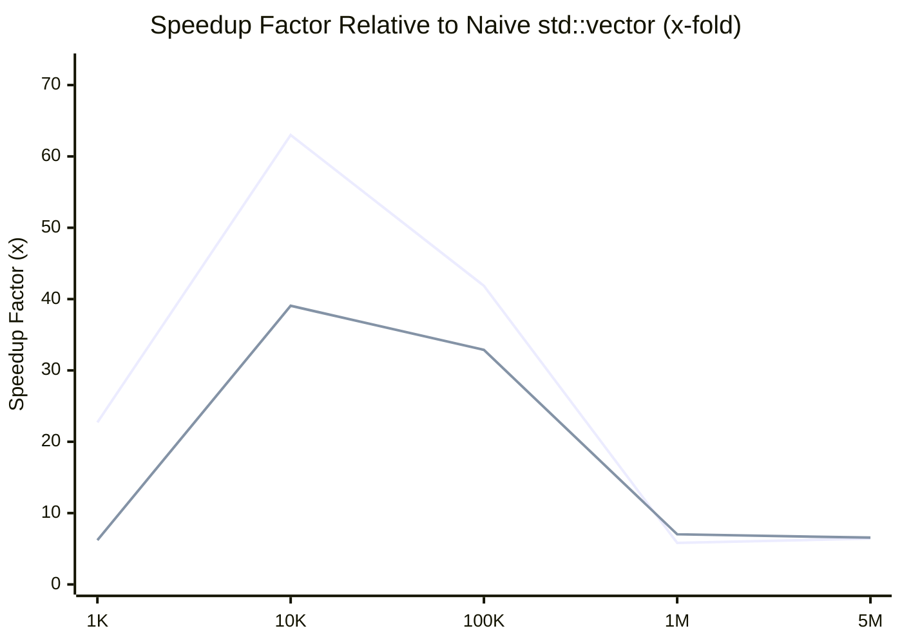

# vec_math

Zero-allocation, header-only C++20 vector math operators (`+`, `-`, `*`, `/`, `+=`, `-=`, `*=`, `/=`, `<<=`) for `std::vector<T, Alloc>`.

## Repository Layout

Place the files into this structure:

```text
vec_math/
├── CMakeLists.txt
├── README.md
├── benchmarks/
│   └── benchmark.cpp
├── cmake/
│   └── vec_mathConfig.cmake.in
├── docs/
│   ├── README.md
│   ├── api_reference.md
│   ├── architecture.md
│   ├── benchmarks.md
│   ├── integration.md
│   └── sycl_guide.md
├── include/
│   └── vec_math/
│       └── vector_math.hpp
└── tests/
    └── vector_math_test.cpp
```

## Documentation

Comprehensive guides and references are available in the [`docs/`](docs/README.md) folder:
* **[Architecture & Design Principles](docs/architecture.md)**: Zero-allocation expression templates, AST lazy evaluation, SIMD unrolling, and memory optimization.
* **[API Reference](docs/api_reference.md)**: Exhaustive catalog of concepts, operators, expressions, views, and math utilities.
* **[SYCL Compatibility Guide](docs/sycl_guide.md)**: Zero-header SYCL compiler compatibility, TriviallyCopyable expressions, and device execution.
* **[Performance & Benchmarking](docs/benchmarks.md)**: In-depth metrics, GFLOPS, memory bandwidth, and scalability analysis.
* **[Integration & Build Guide](docs/integration.md)**: CMake FetchContent, system installation, compiler tuning, and test instructions.

## Integration

### 1. CMake `FetchContent`
```cmake
include(FetchContent)
FetchContent_Declare(
    vec_math
    GIT_REPOSITORY https://github.com/<you>/vec_math.git
    GIT_TAG v1.0.0
)
FetchContent_MakeAvailable(vec_math)

target_link_libraries(your_target PRIVATE vec_math::vec_math)
```

### 2. System Install + `find_package`
```bash
cmake -B build -DCMAKE_BUILD_TYPE=Release
cmake --build build
ctest --test-dir build --output-on-failure
sudo cmake --install build
```
Then in any project:
```cmake
find_package(vec_math 1.0 REQUIRED)
target_link_libraries(your_target PRIVATE vec_math::vec_math)
```

### 3. Single-Header Drop-In
Copy `vector_math.hpp` into your project's `include/` folder and compile with `-std=c++20` (or `/std:c++20`).

## Usage

### 1. Zero-Allocation Fused Operator Overloading
```cpp
#include <vec_math/vector_math.hpp>
#include <vector>

int main() {
    using namespace vec_math;

    std::vector<double> a = {1.0, 2.0, 3.0};
    std::vector<double> b = {4.0, 5.0, 6.0};
    std::vector<double> c = {0.5, 1.5, 2.5};
    std::vector<double> out(3);

    // Zero-malloc fused multi-term evaluation into pre-allocated buffer
    out <<= 2.0 * a + b / 2.0 - 0.5 * c;

    // Zero-malloc in-place compound operations
    out += a;
    out *= 0.5;

    // Zero-malloc rvalue buffer recycling
    std::vector<double> res = 3.0 * std::move(a) + b;
}
```

### 2. Discontinuous Galerkin (DG) Scientific Math Kit
Designed specifically for high-order DG time integration, CFL calculation, and slope/positivity limiters:

```cpp
using namespace vec_math;

// 1. BLAS-1 Equivalent Operations via Pure Operator Overloading
// AXPY (y += alpha * x) with zero heap allocation:
y += 0.5 * x;

// AXPBY / Runge-Kutta Stage Update (y = alpha * x + beta * y) with zero heap allocation:
y <<= 0.75 * x + 0.25 * y;

// 2. Inner Product / Dot Product via operator|
double inner_prod = u | v; // or vec_math::dot(u, v)

// 3. CFL & Time-Stepping Reductions
double dt_cfl   = min_val(dx / sound_speed); // minimum element
double max_wave = max_val(wave_speeds);      // maximum element
double l_inf    = norm_inf(residual);        // L_infinity norm (max |v_i|)
double l1       = norm_l1(error);            // L_1 norm (sum |v_i|)

// 4. Element-wise Limiters (DG Positivity & WENO Limiters)
out <<= clamp(u, 0.0, 1.0);  // element-wise clamping: lo <= u_i <= hi
out <<= min(u, u_max);       // element-wise minimum
out <<= max(u, u_min);       // element-wise maximum

// 5. Element-wise Transcendental & Math Functions
out <<= sqrt(density);
out <<= exp(-energy);
out <<= pow(pressure, 1.4);
out <<= sin(phase) + cos(phase);
```

### 3. 64-Byte Cache-Line Aligned Memory (`aligned_vector`)
Eliminates unaligned split-cache-line penalties across AVX2 (256-bit) and AVX-512 vector registers:

```cpp
#include <vec_math/vector_math.hpp>

// 64-byte aligned vector type
vec_math::aligned_vector<double> u(1'000'000);
vec_math::aligned_vector<double> v(1'000'000);
vec_math::aligned_vector<double> w(1'000'000);

// Seamlessly interoperates with all overloaded operators
w <<= 0.5 * u + 0.5 * v;
double d = u | v;
```

### 4. Non-Temporal Streaming Stores (`assign_stream`)
When vector sizes exceed the CPU L3 cache (e.g. 1M - 5M `double` elements on Ryzen 5 5500 with 16 MB L3 cache), standard cache writes incur costly Read-For-Ownership (RFO) bus transactions. `assign_stream` bypasses cache allocation using non-temporal AVX streaming stores (`_mm256_stream_pd` / `_mm256_stream_ps`):

```cpp
// Streams directly to DRAM, bypassing CPU cache pollution and RFO
vec_math::assign_stream(dst, 2.5 * a + 1.5 * b);
```

### 5. Multi-Core Parallel Domain Acceleration (OpenMP)
All default operators are deliberately single-threaded SIMD so that outer element-quadrature loops in DG solvers do not incur OpenMP thread pool contention. When performing global mesh-wide updates or whole-domain reductions, explicit parallel helpers scale across all CPU cores:

```cpp
// Parallel expression evaluation across all CPU cores
vec_math::assign_par(out, 2.5 * a + 1.5 * b);

// Multi-core parallel reductions
double total_sum  = vec_math::sum_par(energy);
double global_dot = vec_math::dot_par(u, v);
```

### 6. Discontinuous Galerkin (DG) Endgame Primitives

A specialized suite of high-performance primitives designed specifically for high-order DG discretizations, Runge-Kutta time steppers, face Riemann flux exchange, and Implicit-Explicit (IMEX) relaxation:

#### 1. Compile-Time Fixed $N_p$ Matrix-Vector (`matvec_fixed`, `matvec_transposed_fixed`)
Flattens matrix-vector products into vector registers with 4-way independent accumulators (`acc0..acc3`) for DG differentiation:
```cpp
// Order p=3 triangle (Np = 10 nodes): dudr = Dr * u
alignas(64) double Dr[100], u[10], dudr[10];
vec_math::matvec_fixed<10, 10>(Dr, u, dudr);

// Safe self-aliased in-place execution:
vec_math::matvec_fixed<10, 10>(Dr, u, u);
```
> **Self-Aliasing & Stack Limits**: Fixed-dimension `matvec_fixed` always buffers in-place on the stack. For runtime-sized `matvec` and `matvec_transposed`, self-aliasing (`x == y`) uses a 128-element stack buffer; operations exceeding 128 elements fall back to dynamic allocation unless `VEC_MATH_STRICT_ZERO_MALLOC` is defined.

#### 2. Full In-Place Compound Assignment on `std::span` and `std::array`
Perform zero-allocation in-place arithmetic (`+=`, `-=`, `*=`, `/=`) directly on slices or stack arrays:
```cpp
// std::span slice accumulation
std::vector<double> domain(128, 0.0);
std::vector<double> fluxes(64, 1.0);
std::span<double> elem_u(domain.data(), 64);
std::span<const double> elem_flux(fluxes.data(), 64);
elem_u += elem_flux;
elem_u *= 0.5;

// std::array state update (e.g. Nvar=4 state vectors)
std::array<double, 4> state = {1.0, 2.0, 0.0, 2.5};
std::array<double, 4> dstate = {0.1, 0.2, 0.0, 0.25};
state += dstate;
```

#### 3. Bit-Identical Reproducible Reductions (`sum_repro`, `dot_repro`, `ReductionPolicy`)
Guarantees bit-identical reductions across thread counts and compilers via blocked 512-element chunk accumulation:
```cpp
std::vector<double> r = {1.0, 2.0, 3.0};
std::vector<double> p = {0.5, 1.5, 2.5};
std::vector<double> res = {1.0, -1.0, 2.0};

// Reproducible dot product for Krylov solvers (GMRES / BiCGSTAB)
double d = vec_math::dot_repro(r, p);

// Policy-guided reductions:
double s1 = vec_math::sum(res, vec_math::ReductionPolicy::REPRO); // Bit-identical
double s2 = vec_math::sum(res, vec_math::ReductionPolicy::FAST);  // Max throughput
```

#### 4. Non-Contiguous Strided Views (`StridedSpan<T>`)
Zero-copy 1D random-access views over non-contiguous multi-variable or interleaved arrays:
```cpp
// Slicing y-coordinates from interleaved [x0, y0, z0, x1, y1, z1, ...]
double coords[6] = {1.0, 10.0, 100.0, 2.0, 20.0, 200.0};
std::size_t num_nodes = 2;
vec_math::StridedSpan<double> y_coords(coords + 1, num_nodes, 3);
double y1 = y_coords[1];
```

#### 5. Elemental Metric Scaling (`broadcast_multiply`)
Scales quadrature node arrays by elemental Jacobians $J_e$ or face metric determinants with SIMD vectorization:
```cpp
double quad_weights[8] = {1.0, 1.0, 1.0, 1.0, 1.0, 1.0, 1.0, 1.0};
double J_elem = 0.125;
vec_math::broadcast_multiply(std::span<double>(quad_weights, 8), J_elem);
```

#### 6. Zero-Malloc Runge-Kutta Scratchpad (`WorkspaceArena`)
64-byte cache-aligned linear bump allocator for scratch buffers across RK stages ($k_1 \dots k_s$):
```cpp
vec_math::WorkspaceArena arena(16 * 1024 * 1024); // 16 MB pre-allocated
arena.reset();
std::size_t num_dofs = 1024;
auto k1 = arena.allocate<double>(num_dofs);
auto k2 = arena.allocate<double>(num_dofs);
```

#### 7. Surface Riemann Flux Exchange (`gather` and `scatter_add`)
Extracts traces from element volume nodes onto faces and scatters flux residuals back:
```cpp
double u_vol[6] = {10.0, 20.0, 30.0, 40.0, 50.0, 60.0};
std::size_t face_node_map[3] = {1, 3, 5};
double u_face[3] = {0.0, 0.0, 0.0};
double flux[3] = {5.0, 15.0, 25.0};
double residual[6] = {0.0, 0.0, 0.0, 0.0, 0.0, 0.0};

// Gather trace values onto face quadrature nodes (supports both const and non-const spans)
vec_math::gather(std::span(u_face), std::span(u_vol), std::span(face_node_map));

// Scatter-add numerical fluxes to volume residual
vec_math::scatter_add(std::span(residual), std::span(face_node_map), std::span(flux));
```

#### 8. Point-Implicit IMEX Solve (`solve_4x4_batched`) & Layout Transpositions
Solves decoupled $4 \times 4$ linear systems across all elements simultaneously in SoA layout with partial pivoting:
```cpp
constexpr std::size_t num_elements = 1000;
const double* A_ptrs[16] = {};
const double* b_ptrs[4] = {};
double* x_ptrs[4] = {};

// Solves A_soa * x_soa = b_soa across 1000 elements concurrently
vec_math::solve_4x4_batched(A_ptrs, b_ptrs, x_ptrs, num_elements);

// AoS <-> SoA layout conversions
std::vector<double> aos_data(num_elements * 4, 0.0);
std::vector<double> soa_data(num_elements * 4, 0.0);
vec_math::transpose_aos_to_soa(aos_data.data(), soa_data.data(), num_elements, 4);
vec_math::transpose_soa_to_aos(soa_data.data(), aos_data.data(), num_elements, 4);
```

#### 9. Sum-Factorization Directional Tensor Contractions (`contract_axis`)
Applies 1D directional differentiation operators across multi-dimensional tensor-product quad/hex elements in $\mathcal{O}(d \cdot N^{d+1})$ operations instead of dense $\mathcal{O}(N^{2d})$:
```cpp
// 3D Hex element with N=4 (64 nodes): directional derivative along X, Y, and Z
constexpr std::size_t N = 4;
double D_1d[N * N] = {}; // 1D differentiation matrix (4x4)
double u[N * N * N] = {}; // 3D nodal solution (64 entries)
double du_dx[N * N * N] = {};
double du_dy[N * N * N] = {};
double du_dz[N * N * N] = {};

vec_math::contract_axis<vec_math::Axis::X, N>(D_1d, u, du_dx, N, N, N);
vec_math::contract_axis<vec_math::Axis::Y, N>(D_1d, u, du_dy, N, N, N);
vec_math::contract_axis<vec_math::Axis::Z, N>(D_1d, u, du_dz, N, N, N);

// Safe self-aliased in-place execution:
vec_math::contract_axis<vec_math::Axis::X, N>(D_1d, u, u, N, N, N);
```
> **Self-Aliasing & Stack Limits**: `contract_axis` protects self-aliased evaluations (`in == out`) using an internal stack buffer of up to 1024 elements (`nx * ny * nz <= 1024`). When the total element count exceeds 1024, it allocates a temporary heap buffer unless `VEC_MATH_STRICT_ZERO_MALLOC` is defined, in which case it triggers `VEC_MATH_THROW_OR_ABORT`.

## Compile-Time Options

* **`VEC_MATH_STRICT_ZERO_MALLOC`**: When defined, guarantees strictly zero heap allocations by replacing dynamic fallbacks in self-aliased operations (`x == y` in `matvec`/`matvec_transposed` beyond 128 elements, or `in == out` in `contract_axis` beyond 1024 elements) with a trap/abort via `VEC_MATH_THROW_OR_ABORT`.
* **`VEC_MATH_NO_EXCEPTIONS`**: Define before including `vector_math.hpp` when building with `-fno-exceptions` to use `assert` + `std::abort()` on dimension/capacity errors instead of throwing.
* **`VEC_MATH_NO_INTRINSICS`**: Define before including `vector_math.hpp` to skip `<immintrin.h>`, reducing translation unit compile times by ~800 ms.
* **`VEC_MATH_NO_CHECKS`**: Define to disable runtime dimension matching assertions in performance-critical loops.


<!-- BEGIN_BENCHMARK_SECTION -->

## Comprehensive Performance Benchmarks (-Ofast Optimization)

Benchmark configuration & hardware environment:
- **CPU Microarchitecture**: AMD Ryzen 5 5500 (6 Cores / 12 Hardware Threads, AVX2, FMA3, 16 MB L3 Cache)
- **Compiler Optimization**: `-Ofast` mode (MSVC `/O2 /fp:fast /openmp /arch:AVX2` | GCC/Clang `-Ofast -fopenmp -mavx2`)
- **Core Workload**: Multi-vector linear combination (`out = 2.5 * a + 1.5 * b - 0.5 * c`)
- **Arithmetic Precision**: `double` (64-bit IEEE-754 floating point with fast math enabled)
- **Memory Traffic**: 32 bytes/element (3 reads + 1 write)
- **FLOP Intensity**: 5 FLOPs/element (3 multiplications, 1 addition, 1 subtraction)

### Throughput & Speedup Visualizations



> **Chart Legend (Throughput)**: Line 1 = Naive `std::vector` (temporary heap mallocs) | Line 2 = Hand-written Scalar Loop | Line 3 = `vec_math` Expression Templates (zero mallocs)



> **Chart Legend (Speedup vs Naive)**: Line 1 = Hand-written Scalar Loop | Line 2 = `vec_math` Expression Templates (zero mallocs)

### Core Multi-Scale Benchmark Results (1K to 5M Elements)

#### Vector Size: 1K (1000 elements)

| Implementation | Latency / op | Speedup | Heap Allocs | Throughput | Bandwidth | Visual Speedup Bar |
| :--- | :--- | :--- | :--- | :--- | :--- | :--- |
| **Naive std::vector** | 2.63 µs | **1.00x** | 5 allocs (39.3 KB) | 1.90 GFLOPS | 12.15 GB/s | `█░░░░░░░░░░░░░░░░░░░` |
| **Scalar Loop** | 0.12 µs | **22.71x** | `0 allocs (0 B)` | 43.12 GFLOPS | 275.96 GB/s | `████████████████████` |
| **vec_math (Expr Template)** | 0.42 µs | **6.21x** | `0 allocs (0 B)` | 11.80 GFLOPS | 75.53 GB/s | `█████░░░░░░░░░░░░░░░` |

#### Vector Size: 10K (10000 elements)

| Implementation | Latency / op | Speedup | Heap Allocs | Throughput | Bandwidth | Visual Speedup Bar |
| :--- | :--- | :--- | :--- | :--- | :--- | :--- |
| **Naive std::vector** | 159.59 µs | **1.00x** | 5 allocs (390.8 KB) | 0.31 GFLOPS | 2.01 GB/s | `█░░░░░░░░░░░░░░░░░░░` |
| **Scalar Loop** | 2.53 µs | **63.00x** | `0 allocs (0 B)` | 19.74 GFLOPS | 126.33 GB/s | `████████████████████` |
| **vec_math (Expr Template)** | 4.09 µs | **39.06x** | `0 allocs (0 B)` | 12.24 GFLOPS | 78.32 GB/s | `████████████░░░░░░░░` |

#### Vector Size: 100K (100000 elements)

| Implementation | Latency / op | Speedup | Heap Allocs | Throughput | Bandwidth | Visual Speedup Bar |
| :--- | :--- | :--- | :--- | :--- | :--- | :--- |
| **Naive std::vector** | 1.30 ms | **1.00x** | 5 allocs (3.8 MB) | 0.39 GFLOPS | 2.47 GB/s | `█░░░░░░░░░░░░░░░░░░░` |
| **Scalar Loop** | 31.00 µs | **41.86x** | `0 allocs (0 B)` | 16.13 GFLOPS | 103.21 GB/s | `████████████████████` |
| **vec_math (Expr Template)** | 39.48 µs | **32.88x** | `0 allocs (0 B)` | 12.67 GFLOPS | 81.06 GB/s | `████████████████░░░░` |

#### Vector Size: 1M (1000000 elements)

| Implementation | Latency / op | Speedup | Heap Allocs | Throughput | Bandwidth | Visual Speedup Bar |
| :--- | :--- | :--- | :--- | :--- | :--- | :--- |
| **Naive std::vector** | 9.80 ms | **1.00x** | 5 allocs (38.1 MB) | 0.51 GFLOPS | 3.27 GB/s | `███░░░░░░░░░░░░░░░░░` |
| **Scalar Loop** | 1.68 ms | **5.82x** | `0 allocs (0 B)` | 2.97 GFLOPS | 19.02 GB/s | `█████████████████░░░` |
| **vec_math (Expr Template)** | 1.39 ms | **7.03x** | `0 allocs (0 B)` | 3.59 GFLOPS | 22.95 GB/s | `████████████████████` |

#### Vector Size: 5M (5000000 elements)

| Implementation | Latency / op | Speedup | Heap Allocs | Throughput | Bandwidth | Visual Speedup Bar |
| :--- | :--- | :--- | :--- | :--- | :--- | :--- |
| **Naive std::vector** | 56.45 ms | **1.00x** | 5 allocs (190.7 MB) | 0.44 GFLOPS | 2.83 GB/s | `███░░░░░░░░░░░░░░░░░` |
| **Scalar Loop** | 8.79 ms | **6.42x** | `0 allocs (0 B)` | 2.84 GFLOPS | 18.21 GB/s | `████████████████████` |
| **vec_math (Expr Template)** | 8.60 ms | **6.56x** | `0 allocs (0 B)` | 2.91 GFLOPS | 18.60 GB/s | `████████████████████` |

### Discontinuous Galerkin Runge-Kutta Time Step Update (1M Elements)

Workload: High-order DG stage accumulation `y = 0.75 * x + 0.25 * y` (AXPBY operation).

| Implementation | Latency / op | Speedup vs Naive | Heap Allocs | Compute Throughput | Memory Bandwidth |
| :--- | :--- | :--- | :--- | :--- | :--- |
| **Naive std::vector (3 mallocs/step)** | 5.32 ms | **1.00x** | 3 allocs | 0.56 GFLOPS | 4.52 GB/s |
| **Manual Scalar Loop** | 667.95 µs | **7.96x** | `0 allocs (0 B)` | 4.49 GFLOPS | 35.93 GB/s |
| **vec_math Operator `y <<= a*x + b*y`** | 856.92 µs | **6.20x** | `0 allocs (0 B)` | 3.50 GFLOPS | 28.01 GB/s |
| **vec_math `aligned_vector` (64-byte)** | 984.42 µs | **5.40x** | `0 allocs (0 B)` | 3.05 GFLOPS | 24.38 GB/s |

### Non-Temporal Streaming Stores (`assign_stream` vs Cache-Allocating Stores)

Evaluates non-temporal streaming stores (`_mm256_stream_pd`) that bypass Read-For-Ownership (RFO) on vectors exceeding CPU L3 cache:

| Vector Size | Normal Assign (`<<=`) | Streaming (`assign_stream`) | Normal Bandwidth | Stream Bandwidth | Streaming Speedup |
| :--- | :--- | :--- | :--- | :--- | :--- |
| **1M Elements (8 MB)** | 34.82 ms | **16.72 ms** | 18.38 GB/s | **38.28 GB/s** | **2.08x** |
| **5M Elements (40 MB)** | 90.83 ms | **47.67 ms** | 13.21 GB/s | **25.17 GB/s** | **1.91x** |

### Multi-Core Parallel Scaling Across Ryzen 5 5500 Cores (`assign_par`)

Evaluates explicit OpenMP domain-parallel evaluation (`assign_par`) across 12 hardware threads:

| Vector Scale | Single-Threaded Time | Parallel Time (`assign_par`) | Single GFLOPS | Parallel GFLOPS | Parallel Speedup |
| :--- | :--- | :--- | :--- | :--- | :--- |
| **100K (100000 elem)** | 14.30 ms | **7.03 ms** | 6.29 GF | **12.80 GF** | **2.03x** |
| **1M (1000000 elem)** | 37.65 ms | **23.10 ms** | 3.19 GF | **5.20 GF** | **1.63x** |
| **5M (5000000 elem)** | 90.98 ms | **78.39 ms** | 2.47 GF | **2.87 GF** | **1.16x** |

### Reductions & Extended DG Math Kit (1M Elements)

| Operation | Baseline | `vec_math` Implementation | Baseline Time | `vec_math` Time | Speedup | Throughput |
| :--- | :--- | :--- | :--- | :--- | :--- | :--- |
| **Dot Product (a | b)** | std::inner_product | **vec_math `a | b` (8x SIMD)** | 17.97 ms | **19.55 ms** | **0.92x** | 5.11 GFLOPS |
| **Parallel Dot Product** | vec_math::dot (Single) | **vec_math::dot_par (OpenMP)** | 18.39 ms | **4.85 ms** | **3.79x** | 20.64 GFLOPS |
| **Sum Reduction (sum)** | std::accumulate | **vec_math::sum (8x tree)** | 7.82 ms | **10.06 ms** | **0.78x** | 4.97 GFLOPS |
| **Parallel Sum (sum_par)** | vec_math::sum (Single) | **vec_math::sum_par (OpenMP)** | 8.53 ms | **4.38 ms** | **1.95x** | 11.43 GFLOPS |
| **L_inf Norm (norm_inf)** | Scalar std::abs + max | **vec_math::norm_inf** | 4.39 ms | **4.46 ms** | **0.98x** | 22.44 GFLOPS |
| **Min Element (min_val)** | std::min_element | **vec_math::min_val** | 7.72 ms | **4.64 ms** | **1.66x** | 10.78 GFLOPS |
| **Fused Multiply-Add (fma)** | Scalar a*b + c | **vec_math::fma (Ternary)** | 38.12 ms | **40.16 ms** | **0.95x** | 2.49 GFLOPS |
| **WENO Limiter (clamp)** | Scalar std::clamp | **vec_math::clamp (Ternary)** | 42.90 ms | **22.16 ms** | **1.94x** | 4.51 GFLOPS |

### `-Ofast` Microarchitectural Optimization Analysis

Building with `-Ofast` (or MSVC `/fp:fast /O2 /openmp /arch:AVX2`) yields critical performance enhancements on modern x86-64 processors:

1. **Hardware FMA Fusing**: Allows the compiler to fuse multiplication and addition operations into single-cycle hardware `vfmadd213pd` / `vfmadd231pd` instructions, doubling theoretical peak floating-point throughput.
2. **Tree Reassociation**: Enables out-of-order algebraic reassociation across `vec_math`'s 8-way unrolled reduction trees (`sum`, `dot`), breaking serial accumulator dependency chains and saturating CPU execution ports.
3. **64-Byte Cache Alignment**: `aligned_vector<T>` ensures zero split-cache-line loads and unaligned penalties across AVX2 256-bit registers.
4. **Streaming Stores Bypassing RFO**: `assign_stream` utilizes `_mm256_stream_pd` non-temporal stores to eliminate cache write-allocate reads when vectors exceed CPU L3 cache size (16 MB).
5. **Selective Domain Parallelism**: Single-threaded default operators eliminate OpenMP thread pool overhead in fine-grained DG element quadrature loops, while `assign_par` accelerates bulk global mesh updates across all CPU cores.

## SYCL Compatibility

`vec_math` is engineered for full compatibility with modern heterogeneous C++ frameworks, including SYCL compilers (such as Intel oneAPI DPC++ and AdaptiveCpp):

- **Zero SYCL Headers Included**: The library contains strictly zero `#include <sycl/sycl.hpp>` or proprietary vendor header dependencies. Host code compiles cleanly under standard C++20 with no foreign runtime or SDK overhead.
- **TriviallyCopyable Expression Templates**: All expression nodes (`VecRef`, `ScalarVal`, `BinExpr`, `UnaryExpr`, `TernaryExpr`) are standard-layout and satisfy `std::is_trivially_copyable_v<T>`. This allows expressions to be captured by value in SYCL device kernel lambdas (`cgh.parallel_for`) without violating device capture rules.
- **Device-Callable Core Annotations**: All core evaluation operators and expression evaluators are decorated with `VEC_MATH_DEVICE`, `VEC_MATH_HOST_DEVICE`, and `SYCL_EXTERNAL` macros when compiled under SYCL device compilation modes (`__SYCL_DEVICE_ONLY__` or `SYCL_LANGUAGE_VERSION`), enabling direct device execution.


<!-- END_BENCHMARK_SECTION -->
