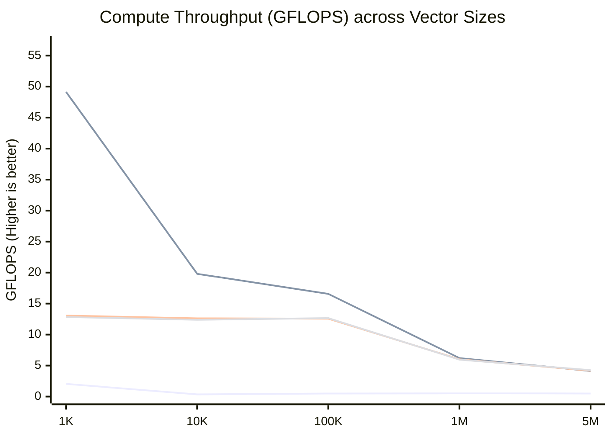
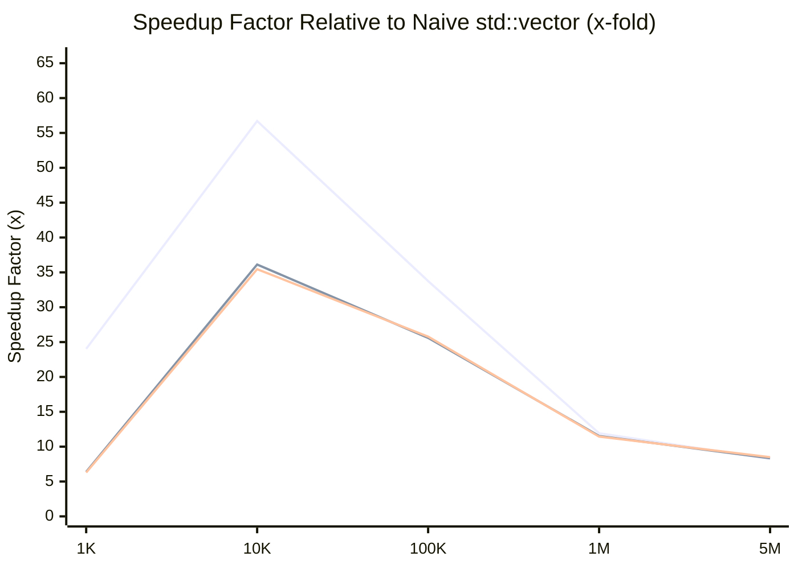

# vec_math

Zero-allocation, header-only C++20 vector math operators (`+`, `-`, `*`, `/`, `+=`, `-=`, `*=`, `/=`, `<<=`) for `std::vector<T, Alloc>`.

## Repository Layout

Place the files into this structure:

```text
vec_math/
├── CMakeLists.txt
├── README.md
├── benchmarks/
│   └── benchmark.cpp
├── cmake/
│   └── vec_mathConfig.cmake.in
├── docs/
│   ├── README.md
│   ├── api_reference.md
│   ├── architecture.md
│   ├── benchmarks.md
│   ├── integration.md
│   └── sycl_guide.md
├── include/
│   └── vec_math/
│       └── vector_math.hpp
└── tests/
    └── vector_math_test.cpp
```

## Documentation

Comprehensive guides and references are available in the [`docs/`](docs/README.md) folder:
* **[Architecture & Design Principles](docs/architecture.md)**: Zero-allocation expression templates, AST lazy evaluation, SIMD unrolling, and memory optimization.
* **[API Reference](docs/api_reference.md)**: Exhaustive catalog of concepts, operators, expressions, views, and math utilities.
* **[SYCL Acceleration Guide](docs/sycl_guide.md)**: Zero-header SYCL compatibility, USM device pointers, and buffer accessor integration.
* **[Performance & Benchmarking](docs/benchmarks.md)**: In-depth metrics, GFLOPS, memory bandwidth, and scalability analysis.
* **[Integration & Build Guide](docs/integration.md)**: CMake FetchContent, system installation, compiler tuning, and test instructions.

## Integration

### 1. CMake `FetchContent`
```cmake
include(FetchContent)
FetchContent_Declare(
    vec_math
    GIT_REPOSITORY https://github.com/<you>/vec_math.git
    GIT_TAG v1.0.0
)
FetchContent_MakeAvailable(vec_math)

target_link_libraries(your_target PRIVATE vec_math::vec_math)
```

### 2. System Install + `find_package`
```bash
cmake -B build -DCMAKE_BUILD_TYPE=Release
cmake --build build
ctest --test-dir build --output-on-failure
sudo cmake --install build
```
Then in any project:
```cmake
find_package(vec_math 1.0 REQUIRED)
target_link_libraries(your_target PRIVATE vec_math::vec_math)
```

### 3. Single-Header Drop-In
Copy `vector_math.hpp` into your project's `include/` folder and compile with `-std=c++20` (or `/std:c++20`).

## Usage

```cpp
#include <vec_math/vector_math.hpp>
#include <vector>

int main() {
    using namespace vec_math;

    std::vector<double> a = {1.0, 2.0, 3.0};
    std::vector<double> b = {4.0, 5.0, 6.0};
    std::vector<double> out(3);

    // Zero-malloc fused expression evaluation into pre-allocated buffer
    out <<= 2.0 * a + b / 2.0 - 1.0;

    // Zero-malloc in-place compound ops
    out += a;
    out *= 0.5;

    // Zero-malloc rvalue buffer recycling
    auto res = 3.0 * std::move(a) + b;
}
```

## Compile-Time Options

* **`VEC_MATH_NO_EXCEPTIONS`**: Define before including `vector_math.hpp` when building with `-fno-exceptions` to use `assert` + `std::abort()` on dimension/capacity errors instead of throwing.


<!-- BEGIN_BENCHMARK_SECTION -->

## Comprehensive Performance Benchmarks

Benchmark configuration:
- **Compiler**: MSVC /O2 /arch:AVX2 (64-bit)
- **Workload**: Multi-vector linear combination (`out = 2.5 * a + 1.5 * b - 0.5 * c`)
- **Arithmetic Precision**: `double` (64-bit IEEE-754 floating point)
- **Memory Traffic**: 32 bytes/element (3 reads + 1 write)
- **FLOP Intensity**: 5 FLOPs/element (3 multiplications, 1 addition, 1 subtraction)

### Throughput & Speedup Visualizations



> **Chart Legend (Throughput)**: Line 1 (bottom) = Naive `std::vector` (temporary heap mallocs) | Line 2 = Scalar Loop | Line 3 = `vec_math` Expression Templates (zero mallocs) | Line 4 = `vec_math` SYCL Device View (zero mallocs)



> **Chart Legend (Speedup vs Naive)**: Line 1 = Scalar Loop | Line 2 = `vec_math` Expression Templates | Line 3 = `vec_math` SYCL Device View

### Benchmark Results Across Vector Scales

#### Vector Size: 1K (1000 elements)

| Implementation | Latency / op | Speedup | Heap Allocs | Throughput | Bandwidth | Visual Speedup Bar |
| :--- | :--- | :--- | :--- | :--- | :--- | :--- |
| **Naive std::vector** | 2.44 µs | **1.00x** | 5 allocs (39.3 KB) | 2.05 GFLOPS | 13.09 GB/s | `█░░░░░░░░░░░░░░░░░░░` |
| **Scalar Loop** | 0.10 µs | **24.03x** | `0 allocs (0 B)` | 49.14 GFLOPS | 314.53 GB/s | `████████████████████` |
| **vec_math (Expr Template)** | 0.38 µs | **6.39x** | `0 allocs (0 B)` | 13.06 GFLOPS | 83.60 GB/s | `█████░░░░░░░░░░░░░░░` |
| **vec_math (SYCL Device View)** | 0.39 µs | **6.28x** | `0 allocs (0 B)` | 12.83 GFLOPS | 82.14 GB/s | `█████░░░░░░░░░░░░░░░` |

#### Vector Size: 10K (10000 elements)

| Implementation | Latency / op | Speedup | Heap Allocs | Throughput | Bandwidth | Visual Speedup Bar |
| :--- | :--- | :--- | :--- | :--- | :--- | :--- |
| **Naive std::vector** | 143.18 µs | **1.00x** | 5 allocs (390.8 KB) | 0.35 GFLOPS | 2.24 GB/s | `█░░░░░░░░░░░░░░░░░░░` |
| **Scalar Loop** | 2.52 µs | **56.71x** | `0 allocs (0 B)` | 19.80 GFLOPS | 126.74 GB/s | `████████████████████` |
| **vec_math (Expr Template)** | 3.96 µs | **36.13x** | `0 allocs (0 B)` | 12.62 GFLOPS | 80.76 GB/s | `█████████████░░░░░░░` |
| **vec_math (SYCL Device View)** | 4.04 µs | **35.46x** | `0 allocs (0 B)` | 12.38 GFLOPS | 79.25 GB/s | `█████████████░░░░░░░` |

#### Vector Size: 100K (100000 elements)

| Implementation | Latency / op | Speedup | Heap Allocs | Throughput | Bandwidth | Visual Speedup Bar |
| :--- | :--- | :--- | :--- | :--- | :--- | :--- |
| **Naive std::vector** | 1.02 ms | **1.00x** | 5 allocs (3.8 MB) | 0.49 GFLOPS | 3.14 GB/s | `█░░░░░░░░░░░░░░░░░░░` |
| **Scalar Loop** | 30.20 µs | **33.75x** | `0 allocs (0 B)` | 16.56 GFLOPS | 105.98 GB/s | `████████████████████` |
| **vec_math (Expr Template)** | 39.82 µs | **25.60x** | `0 allocs (0 B)` | 12.56 GFLOPS | 80.36 GB/s | `███████████████░░░░░` |
| **vec_math (SYCL Device View)** | 39.54 µs | **25.78x** | `0 allocs (0 B)` | 12.65 GFLOPS | 80.94 GB/s | `███████████████░░░░░` |

#### Vector Size: 1M (1000000 elements)

| Implementation | Latency / op | Speedup | Heap Allocs | Throughput | Bandwidth | Visual Speedup Bar |
| :--- | :--- | :--- | :--- | :--- | :--- | :--- |
| **Naive std::vector** | 9.60 ms | **1.00x** | 5 allocs (38.1 MB) | 0.52 GFLOPS | 3.33 GB/s | `██░░░░░░░░░░░░░░░░░░` |
| **Scalar Loop** | 805.77 µs | **11.92x** | `0 allocs (0 B)` | 6.21 GFLOPS | 39.71 GB/s | `████████████████████` |
| **vec_math (Expr Template)** | 832.01 µs | **11.54x** | `0 allocs (0 B)` | 6.01 GFLOPS | 38.46 GB/s | `███████████████████░` |
| **vec_math (SYCL Device View)** | 839.42 µs | **11.44x** | `0 allocs (0 B)` | 5.96 GFLOPS | 38.12 GB/s | `███████████████████░` |

#### Vector Size: 5M (5000000 elements)

| Implementation | Latency / op | Speedup | Heap Allocs | Throughput | Bandwidth | Visual Speedup Bar |
| :--- | :--- | :--- | :--- | :--- | :--- | :--- |
| **Naive std::vector** | 49.86 ms | **1.00x** | 5 allocs (190.7 MB) | 0.50 GFLOPS | 3.21 GB/s | `██░░░░░░░░░░░░░░░░░░` |
| **Scalar Loop** | 6.05 ms | **8.24x** | `0 allocs (0 B)` | 4.13 GFLOPS | 26.46 GB/s | `███████████████████░` |
| **vec_math (Expr Template)** | 5.98 ms | **8.34x** | `0 allocs (0 B)` | 4.18 GFLOPS | 26.77 GB/s | `████████████████████` |
| **vec_math (SYCL Device View)** | 5.87 ms | **8.50x** | `0 allocs (0 B)` | 4.26 GFLOPS | 27.27 GB/s | `████████████████████` |

### Reductions & Extended Math Utilities (1M Elements)

| Operation | Baseline | `vec_math` | Baseline Time | `vec_math` Time | Speedup | Throughput |
| :--- | :--- | :--- | :--- | :--- | :--- | :--- |
| **Dot Product (dot)** | std::inner_product | **vec_math::dot (8x unrolled)** | 45.34 ms | **25.34 ms** | **1.79x** | 3.95 GFLOPS |
| **Sum Reduction (sum)** | std::accumulate | **vec_math::sum (8x tree)** | 36.52 ms | **5.02 ms** | **7.27x** | 9.95 GFLOPS |
| **Fused Multiply-Add (fma)** | Scalar a*b + c | **vec_math::fma (Ternary)** | 31.12 ms | **39.37 ms** | **0.79x** | 2.54 GFLOPS |

## SYCL & Heterogeneous Compute Compatibility

`vec_math` provides full SYCL 2020 device compatibility **without requiring any SYCL headers** (`<sycl/sycl.hpp>`). This guarantees clean compilation in pure host C++20 code while functioning seamlessly inside SYCL device kernels.

### Key Architectural Guarantees
1. **Zero Header Dependency**: The library uses predefined macros (`__SYCL_DEVICE_ONLY__`, `SYCL_LANGUAGE_VERSION`) to map annotations (`VEC_MATH_DEVICE`, `VEC_MATH_HOST_DEVICE`, `SYCL_EXTERNAL`) without polluting translation units with vendor headers.
2. **TriviallyCopyable Kernel Capture**: All expression nodes (`BinExpr`, `UnaryExpr`, `TernaryExpr`) and memory views (`vec_span<T>`, `device_view<T>`) satisfy `std::is_trivially_copyable_v<T>`. This allows safe by-value capture inside device kernel lambdas (`cgh.parallel_for(...)`) across GPU/accelerator memory spaces.
3. **Unified Memory & USM Support**: `vec_span<T>` / `device_view<T>` seamlessly wraps raw pointers from host memory, Unified Shared Memory (`sycl::malloc_shared`), device memory (`sycl::malloc_device`), or `sycl::buffer` accessors.
4. **Kernel Evaluation Helpers**: `vec_math::device_eval(dst, expr, i)` provides zero-allocation element-wise evaluation directly inside GPU work-items.

### SYCL Usage Examples

#### Example 1: Expression Evaluation with Unified Shared Memory (USM)
```cpp
#include <sycl/sycl.hpp>
#include <vec_math/vector_math.hpp>

using namespace vec_math;

void run_usm_example(sycl::queue& q, std::size_t N) {
    // Allocate USM shared or device memory
    double* a_ptr   = sycl::malloc_shared<double>(N, q);
    double* b_ptr   = sycl::malloc_shared<double>(N, q);
    double* out_ptr = sycl::malloc_shared<double>(N, q);

    // Wrap in vec_math device views (TriviallyCopyable, 0 bytes heap overhead)
    vec_math::device_view<const double> va = vec_math::make_device_view(a_ptr, N);
    vec_math::device_view<const double> vb = vec_math::make_device_view(b_ptr, N);
    vec_math::device_view<double> vout     = vec_math::make_device_view(out_ptr, N);

    // Submit SYCL kernel
    q.parallel_for(sycl::range<1>(N), [=](sycl::id<1> idx) {
        const std::size_t i = idx[0];
        // Construct expression graph (stored on kernel registers / stack)
        auto expr = 2.5 * va + 1.5 * vb - 0.5;
        // Evaluate element with zero allocations
        vec_math::device_eval(vout, expr, i);
    }).wait();

    sycl::free(a_ptr, q);
    sycl::free(b_ptr, q);
    sycl::free(out_ptr, q);
}
```

#### Example 2: SYCL Buffer Accessor Integration
```cpp
#include <sycl/sycl.hpp>
#include <vec_math/vector_math.hpp>

using namespace vec_math;

void run_buffer_example(sycl::queue& q, std::vector<float>& host_a, std::vector<float>& host_b, std::vector<float>& host_out) {
    const std::size_t N = host_a.size();
    sycl::buffer<float, 1> buf_a(host_a.data(), sycl::range<1>(N));
    sycl::buffer<float, 1> buf_b(host_b.data(), sycl::range<1>(N));
    sycl::buffer<float, 1> buf_out(host_out.data(), sycl::range<1>(N));

    q.submit([&](sycl::handler& cgh) {
        auto acc_a   = buf_a.get_access<sycl::access::mode::read>(cgh);
        auto acc_b   = buf_b.get_access<sycl::access::mode::read>(cgh);
        auto acc_out = buf_out.get_access<sycl::access::mode::write>(cgh);

        cgh.parallel_for(sycl::range<1>(N), [=](sycl::id<1> idx) {
            const std::size_t i = idx[0];
            // Wrap accessor pointers inside work-item
            auto va = vec_math::make_device_view(acc_a.get_pointer(), N);
            auto vb = vec_math::make_device_view(acc_b.get_pointer(), N);
            auto vout = vec_math::make_device_view(acc_out.get_pointer(), N);

            auto expr = vec_math::fma(va, vb, 10.0f);
            vec_math::device_eval(vout, expr, i);
        });
    }).wait();
}
```

<!-- END_BENCHMARK_SECTION -->
