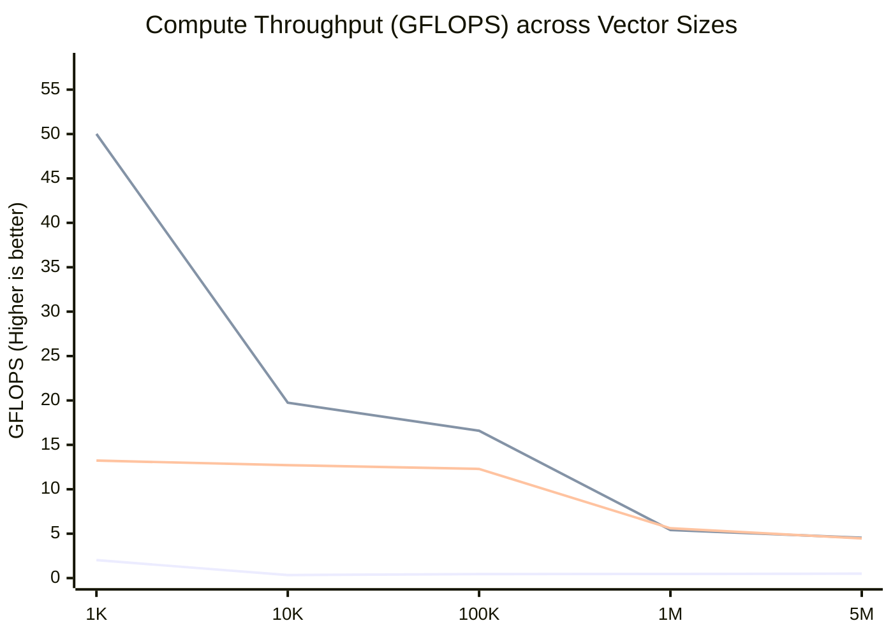
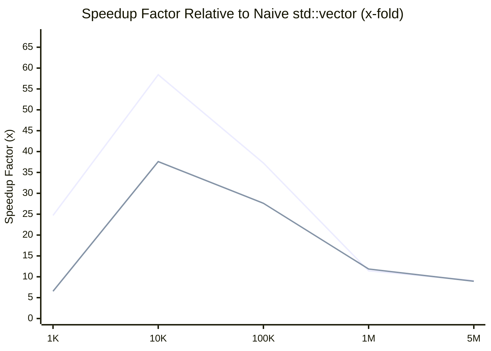

# vec_math

Zero-allocation, header-only C++20 vector math operators (`+`, `-`, `*`, `/`, `+=`, `-=`, `*=`, `/=`, `<<=`) for `std::vector<T, Alloc>`.

## Repository Layout

Place the files into this structure:

```text
vec_math/
├── CMakeLists.txt
├── README.md
├── benchmarks/
│   └── benchmark.cpp
├── cmake/
│   └── vec_mathConfig.cmake.in
├── docs/
│   ├── README.md
│   ├── api_reference.md
│   ├── architecture.md
│   ├── benchmarks.md
│   ├── integration.md
│   └── sycl_guide.md
├── include/
│   └── vec_math/
│       └── vector_math.hpp
└── tests/
    └── vector_math_test.cpp
```

## Documentation

Comprehensive guides and references are available in the [`docs/`](docs/README.md) folder:
* **[Architecture & Design Principles](docs/architecture.md)**: Zero-allocation expression templates, AST lazy evaluation, SIMD unrolling, and memory optimization.
* **[API Reference](docs/api_reference.md)**: Exhaustive catalog of concepts, operators, expressions, views, and math utilities.
* **[SYCL Compatibility Guide](docs/sycl_guide.md)**: Zero-header SYCL compiler compatibility, TriviallyCopyable expressions, and device execution.
* **[Performance & Benchmarking](docs/benchmarks.md)**: In-depth metrics, GFLOPS, memory bandwidth, and scalability analysis.
* **[Integration & Build Guide](docs/integration.md)**: CMake FetchContent, system installation, compiler tuning, and test instructions.

## Integration

### 1. CMake `FetchContent`
```cmake
include(FetchContent)
FetchContent_Declare(
    vec_math
    GIT_REPOSITORY https://github.com/<you>/vec_math.git
    GIT_TAG v1.0.0
)
FetchContent_MakeAvailable(vec_math)

target_link_libraries(your_target PRIVATE vec_math::vec_math)
```

### 2. System Install + `find_package`
```bash
cmake -B build -DCMAKE_BUILD_TYPE=Release
cmake --build build
ctest --test-dir build --output-on-failure
sudo cmake --install build
```
Then in any project:
```cmake
find_package(vec_math 1.0 REQUIRED)
target_link_libraries(your_target PRIVATE vec_math::vec_math)
```

### 3. Single-Header Drop-In
Copy `vector_math.hpp` into your project's `include/` folder and compile with `-std=c++20` (or `/std:c++20`).

## Usage

```cpp
#include <vec_math/vector_math.hpp>
#include <vector>

int main() {
    using namespace vec_math;

    std::vector<double> a = {1.0, 2.0, 3.0};
    std::vector<double> b = {4.0, 5.0, 6.0};
    std::vector<double> out(3);

    // Zero-malloc fused expression evaluation into pre-allocated buffer
    out <<= 2.0 * a + b / 2.0 - 1.0;

    // Zero-malloc in-place compound ops
    out += a;
    out *= 0.5;

    // Zero-malloc rvalue buffer recycling
    auto res = 3.0 * std::move(a) + b;
}
```

## Compile-Time Options

* **`VEC_MATH_NO_EXCEPTIONS`**: Define before including `vector_math.hpp` when building with `-fno-exceptions` to use `assert` + `std::abort()` on dimension/capacity errors instead of throwing.


<!-- BEGIN_BENCHMARK_SECTION -->

## Comprehensive Performance Benchmarks

Benchmark configuration:
- **Compiler**: MSVC /O2 /arch:AVX2 (64-bit)
- **Workload**: Multi-vector linear combination (`out = 2.5 * a + 1.5 * b - 0.5 * c`)
- **Arithmetic Precision**: `double` (64-bit IEEE-754 floating point)
- **Memory Traffic**: 32 bytes/element (3 reads + 1 write)
- **FLOP Intensity**: 5 FLOPs/element (3 multiplications, 1 addition, 1 subtraction)

### Throughput & Speedup Visualizations



> **Chart Legend (Throughput)**: Line 1 = Naive `std::vector` (temporary heap mallocs) | Line 2 = Hand-written Scalar Loop | Line 3 = `vec_math` Expression Templates (zero mallocs)



> **Chart Legend (Speedup vs Naive)**: Line 1 = Hand-written Scalar Loop | Line 2 = `vec_math` Expression Templates (zero mallocs)

### Benchmark Results Across Vector Scales

#### Vector Size: 1K (1000 elements)

| Implementation | Latency / op | Speedup | Heap Allocs | Throughput | Bandwidth | Visual Speedup Bar |
| :--- | :--- | :--- | :--- | :--- | :--- | :--- |
| **Naive std::vector** | 2.47 µs | **1.00x** | 5 allocs (39.3 KB) | 2.02 GFLOPS | 12.96 GB/s | `█░░░░░░░░░░░░░░░░░░░` |
| **Scalar Loop** | 0.10 µs | **24.70x** | `0 allocs (0 B)` | 50.01 GFLOPS | 320.06 GB/s | `████████████████████` |
| **vec_math (Expr Template)** | 0.38 µs | **6.53x** | `0 allocs (0 B)` | 13.23 GFLOPS | 84.64 GB/s | `█████░░░░░░░░░░░░░░░` |

#### Vector Size: 10K (10000 elements)

| Implementation | Latency / op | Speedup | Heap Allocs | Throughput | Bandwidth | Visual Speedup Bar |
| :--- | :--- | :--- | :--- | :--- | :--- | :--- |
| **Naive std::vector** | 147.85 µs | **1.00x** | 5 allocs (390.8 KB) | 0.34 GFLOPS | 2.16 GB/s | `█░░░░░░░░░░░░░░░░░░░` |
| **Scalar Loop** | 2.53 µs | **58.41x** | `0 allocs (0 B)` | 19.75 GFLOPS | 126.42 GB/s | `████████████████████` |
| **vec_math (Expr Template)** | 3.93 µs | **37.60x** | `0 allocs (0 B)` | 12.72 GFLOPS | 81.38 GB/s | `█████████████░░░░░░░` |

#### Vector Size: 100K (100000 elements)

| Implementation | Latency / op | Speedup | Heap Allocs | Throughput | Bandwidth | Visual Speedup Bar |
| :--- | :--- | :--- | :--- | :--- | :--- | :--- |
| **Naive std::vector** | 1.12 ms | **1.00x** | 5 allocs (3.8 MB) | 0.45 GFLOPS | 2.85 GB/s | `█░░░░░░░░░░░░░░░░░░░` |
| **Scalar Loop** | 30.14 µs | **37.26x** | `0 allocs (0 B)` | 16.59 GFLOPS | 106.16 GB/s | `████████████████████` |
| **vec_math (Expr Template)** | 40.68 µs | **27.61x** | `0 allocs (0 B)` | 12.29 GFLOPS | 78.67 GB/s | `███████████████░░░░░` |

#### Vector Size: 1M (1000000 elements)

| Implementation | Latency / op | Speedup | Heap Allocs | Throughput | Bandwidth | Visual Speedup Bar |
| :--- | :--- | :--- | :--- | :--- | :--- | :--- |
| **Naive std::vector** | 10.57 ms | **1.00x** | 5 allocs (38.1 MB) | 0.47 GFLOPS | 3.03 GB/s | `██░░░░░░░░░░░░░░░░░░` |
| **Scalar Loop** | 924.78 µs | **11.43x** | `0 allocs (0 B)` | 5.41 GFLOPS | 34.60 GB/s | `███████████████████░` |
| **vec_math (Expr Template)** | 890.72 µs | **11.87x** | `0 allocs (0 B)` | 5.61 GFLOPS | 35.93 GB/s | `████████████████████` |

#### Vector Size: 5M (5000000 elements)

| Implementation | Latency / op | Speedup | Heap Allocs | Throughput | Bandwidth | Visual Speedup Bar |
| :--- | :--- | :--- | :--- | :--- | :--- | :--- |
| **Naive std::vector** | 50.00 ms | **1.00x** | 5 allocs (190.7 MB) | 0.50 GFLOPS | 3.20 GB/s | `██░░░░░░░░░░░░░░░░░░` |
| **Scalar Loop** | 5.50 ms | **9.09x** | `0 allocs (0 B)` | 4.54 GFLOPS | 29.08 GB/s | `████████████████████` |
| **vec_math (Expr Template)** | 5.60 ms | **8.93x** | `0 allocs (0 B)` | 4.46 GFLOPS | 28.57 GB/s | `████████████████████` |

### Reductions & Extended Math Utilities (1M Elements)

| Operation | Baseline | `vec_math` | Baseline Time | `vec_math` Time | Speedup | Throughput |
| :--- | :--- | :--- | :--- | :--- | :--- | :--- |
| **Dot Product (dot)** | std::inner_product | **vec_math::dot (8x unrolled)** | 38.18 ms | **13.60 ms** | **2.81x** | 7.35 GFLOPS |
| **Sum Reduction (sum)** | std::accumulate | **vec_math::sum (8x tree)** | 36.03 ms | **4.85 ms** | **7.43x** | 10.32 GFLOPS |
| **Fused Multiply-Add (fma)** | Scalar a*b + c | **vec_math::fma (Ternary)** | 30.42 ms | **37.03 ms** | **0.82x** | 2.70 GFLOPS |

## SYCL Compatibility

`vec_math` is engineered for full compatibility with modern heterogeneous C++ frameworks, including SYCL compilers (such as Intel oneAPI DPC++ and AdaptiveCpp):

- **Zero SYCL Headers Included**: The library contains strictly zero `#include <sycl/sycl.hpp>` or proprietary vendor header dependencies. Host code compiles cleanly under standard C++20 with no foreign runtime or SDK overhead.
- **TriviallyCopyable Expression Templates**: All expression nodes (`VecRef`, `ScalarVal`, `BinExpr`, `UnaryExpr`, `TernaryExpr`) are standard-layout and satisfy `std::is_trivially_copyable_v<T>`. This allows expressions to be captured by value in SYCL device kernel lambdas (`cgh.parallel_for`) without violating device capture rules.
- **Device-Callable Core Annotations**: All core evaluation operators and expression evaluators are decorated with `VEC_MATH_DEVICE`, `VEC_MATH_HOST_DEVICE`, and `SYCL_EXTERNAL` macros when compiled under SYCL device compilation modes (`__SYCL_DEVICE_ONLY__` or `SYCL_LANGUAGE_VERSION`), enabling direct device execution.


<!-- END_BENCHMARK_SECTION -->
