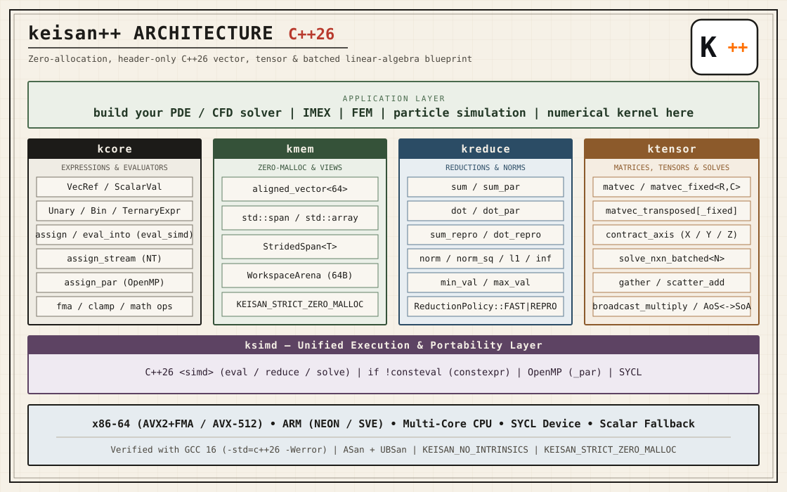

# `keisan++` Architectural Design Guide

This document explains **why** `keisan` is structured the way it is—so you can both use it effectively and apply the same patterns when architecting your own zero-allocation C++26 scientific or SIMD libraries.

---

## 1. The Four-Layer Architecture

Like raylib, `keisan` separates **what the user writes** from **how loops are fused** and **what hardware executes them**:

1. **Application Layer**: Your DG solver, RK time-integrator, or CFD kernel.
2. **Domain Modules (`kcore`, `kmem`, `kreduce`, `ktensor`)**: Clean, composable C++26 APIs with zero hidden heap allocations.
3. **Execution & Portability Layer (`ksimd`)**:
   - **C++26 `<simd>` (`std::simd::vec`)** provides a single portable SIMD implementation for AVX2+FMA, AVX-512, and ARM NEON/SVE.
   - **`if !consteval`** keeps `sum`, `dot`, and expression evaluation `constexpr`-capable without duplicating functions.
   - **`KEISAN_HOST_DEVICE`** (`SYCL_EXTERNAL` when compiled under SYCL) allows expression nodes and scalar kernels to run inside GPU/accelerator kernels without `#include <sycl/sycl.hpp>`.
   - **Non-temporal stores (`assign_stream`)** retain a small `#ifdef __AVX__` / `__SSE2__` fast path because C++26 `<simd>` does not expose cache-bypassing store hints.
4. **Hardware Backends**: x86-64, ARM, OpenMP multi-core, SYCL devices, and `KEISAN_NO_INTRINSICS` scalar fallback.

---

## 2. Core Design Patterns (How to Architect Similar Libraries)

### Pattern A: Trivially-Copyable Expression DAG (`VecRef` + `OperandStorage`)
**Problem**: Traditional expression templates store `const std::vector<T>&` references inside `BinExpr` nodes. That breaks SYCL/GPU kernel capture (host references aren't device-copyable), prevents `constexpr` evaluation, and risks dangling references.

**Solution in `keisan`**:
- `detail::OperandStorage<T>` lowers any contiguous `NumericVector` (`std::vector`, `aligned_vector`, `std::span`, `std::array`) into **`VecRef<Vec>`**—a 16-byte `{const T* ptr_, std::size_t size_}` view.
- `ScalarVal<S>` wraps scalars by value; `StridedSpan<T>` is already a `{T*, size_, stride_}` view.
- Every `UnaryExpr`, `BinExpr`, and `TernaryExpr` is **`TriviallyCopyable`** (`sycl_compatible<T>`), so expression trees pass by value into lambdas, OpenMP regions, and SYCL kernels with zero heap traffic.
- Each AST node exposes `eval_simd<V>(i)` alongside scalar `operator[]`, allowing `eval_into` and compound assignment (`+=`, `-=`, `*=`, `/=`) to evaluate contiguous `double`/`float` expressions (when `detail::can_eval_simd_v` holds) directly in `std::simd::vec` registers.

### Pattern B: Explicit Evaluation Sinks & Zero-Malloc Enforcement
**Problem**: Operator overloading (`a + b * c`) in naive libraries allocates temporary vectors at every `+` or `*`, destroying L1/L2 cache locality.

**Solution in `keisan`**:
- Operators only construct lightweight AST types; **no memory is touched until a sink** (`assign`, `eval_into`, `assign_stream`, `assign_par`, `+=`, or a reduction).
- `WorkspaceArena` pre-allocates a 64-byte-aligned slab once at solver startup and hands out `std::span<T>` slices via bump-pointer arithmetic (`O(1)`, zero `malloc`/`free` inside RK stages).
- Defining `KEISAN_STRICT_ZERO_MALLOC` turns any insufficient-capacity resize (`dst.capacity() < n`) inside `assign()` or `assign_par()` into an immediate `std::bad_alloc`.

### Pattern C: Dual-Accumulator Unrolling (`acc0`, `acc1`) for FMA Latency
**Problem**: On modern out-of-order CPUs (Zen 3, Skylake, Neoverse), floating-point `add`/`fma` has a 3–4 cycle latency. A single SIMD accumulator (`acc += load * load`) stalls at 1 operation every 4 cycles—leaving 75% of FMA throughput on the table.

**Solution in `keisan`**:
- `sum`, `dot`, `norm_l1`, `matvec`, and `contract_axis` maintain **two or four independent accumulators** (`acc0`, `acc1`) and merge them only after the loop. That breaks the loop-carried dependency chain and saturates dual FMA pipes.
- `contract_axis` additionally vectorizes the unit-stride `Axis::Y` and `Axis::Z` slice loops with `std::simd::vec` (`detail::scale_slice` / `detail::axpy_slice`).

### Pattern D: Aliasing Isolation (`KEISAN_RESTRICT` Behind Runtime Alias Checks)
**Problem**: C++ compilers must assume `y[i]` might alias `A[...]` or `x[...]`, forcing them to reload `y[i]` every iteration and blocking SIMD vectorization. Putting `__restrict__` blindly on public APIs causes UB when users pass `matvec(A, x, x, ...)`.

**Solution in `keisan`**:
- Public entry points (`matvec`, `matvec_transposed`, `contract_axis`) perform a cheap pointer-overlap check (`ranges_overlap(y, ...)`).
- When disjoint (the 99.9% case), they dispatch to `detail::*_noalias` helpers whose pointer parameters carry `KEISAN_RESTRICT` (`__restrict__` / `__restrict`).
- `matvec_fixed<Rows, Cols>` buffers `y` into a small stack array when `y` overlaps `x`, avoiding heap allocation.

### Pattern E: Scale-Invariant Singularity Detection in Batched Solvers
**Problem**: In `solve_nxn_batched<N>`, branching inside the element loop (`if (diag == 0) throw`) completely blocks SIMD vectorization across the batch. Meanwhile, a fixed absolute threshold like `1e-20` misses `float` singularities, while a fixed `1e-7` falsely rejects well-conditioned `1e-8 * I` physics Jacobians.

**Solution in `keisan`**:
- Load $N\times N$ matrices across `W = std::simd::vec<T>::size()` elements in SoA layout.
- Track `max_abs = max(|A[r][c]|)` in registers during the initial load, then set `sing_tol = max_abs * (float ? 1e-6 : 1e-14)`.
- Use branchless `std::simd::select` for partial pivoting (hoisting `abs_i` across the pivot loop, and for `N >= 6` reusing `rhs[]` in-place for back-substitution to reduce register pressure without affecting `N <= 4`) and `!(abs_diag > sing_tol)` (which also catches `NaN`), accumulating `any_singular` into a mask and throwing **after** the SIMD loop finishes.

### Pattern F: Bit-Identical Reproducibility (`ReductionPolicy::REPRO`)
**Problem**: SIMD lanes and OpenMP threads reassociate floating-point additions, causing `sum()` / `dot()` results to drift across CPU widths (AVX2 vs AVX-512) or thread counts.

**Solution in `keisan`**:
- `ReductionPolicy::REPRO` (`sum_repro`, `dot_repro`) executes an iterative **pairwise binary-tree reduction** over a fixed 64-element stack buffer—producing bit-identical IEEE-754 results regardless of SIMD ISA or thread count, at ~15–22 GB/s.
