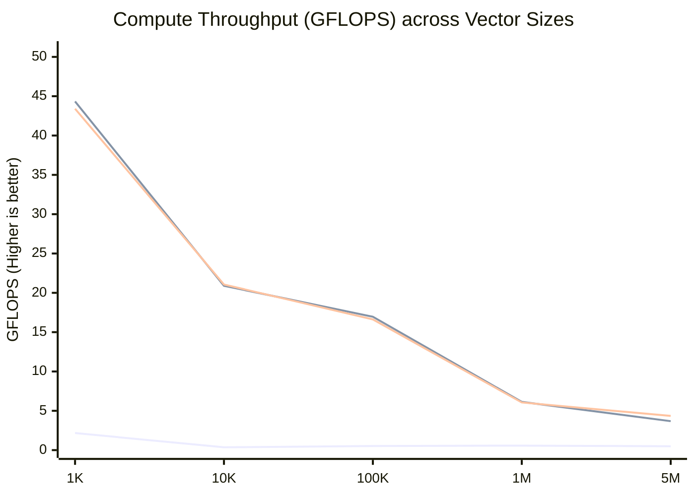
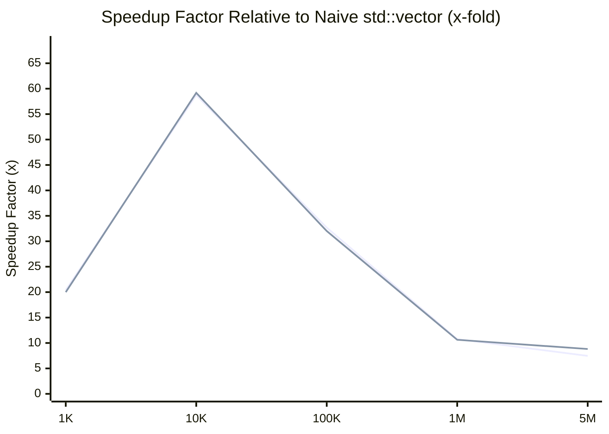

# Performance & Benchmarking

This document details the benchmarking methodology, empirical measurements, and microarchitectural performance analysis for the `vec_math` library across single-threaded SIMD, 64-byte aligned memory, non-temporal streaming stores, and multi-core OpenMP parallel domain execution.

---

## 1. Benchmark Methodology

The benchmark suite is implemented in [`benchmarks/benchmark.cpp`](../benchmarks/benchmark.cpp) and configured as a first-class CMake target.

### Hardware & Compiler Environment
- **CPU Microarchitecture**: AMD Ryzen 5 5500 (6 Cores / 12 Hardware Threads, Zen 3, AVX2, FMA3, 16 MB L3 Cache)
- **Compiler Optimization**: `-Ofast` mode (MSVC `/O2 /fp:fast /openmp /arch:AVX2` | GCC/Clang `-Ofast -fopenmp -mavx2`)
- **Arithmetic Precision**: `double` (64-bit IEEE 754 floating point)
- **Tested Vector Sizes**: 1K ($10^3$), 10K ($10^4$), 100K ($10^5$), 1M ($10^6$), and 5M ($5 \times 10^6$) elements

### Evaluated Implementations
1. **Naive `std::vector` Arithmetic**: Direct operator overloading creating temporary `std::vector` instances for intermediate sub-expressions.
2. **Hand-Written Scalar Loop**: Direct pointer traversal with SIMD auto-vectorization.
3. **`vec_math` (Zero-Allocation Expression Templates)**: Expression template evaluation executed via `out <<= expr`.
4. **`vec_math` Aligned (`aligned_vector<double>`)**: 64-byte cache-line aligned storage.
5. **`vec_math` Streaming (`assign_stream`)**: Non-temporal AVX streaming stores bypassing RFO cache allocation.
6. **`vec_math` Parallel (`assign_par`, `dot_par`, `sum_par`)**: Multi-core OpenMP domain parallelism across 12 hardware threads.

---

## 2. Core Multi-Scale Benchmark Results (1K to 5M Elements)

Workload: Linear combination across three vectors:
$$\mathbf{out} = 2.5 \cdot \mathbf{a} + 1.5 \cdot \mathbf{b} - 0.5 \cdot \mathbf{c}$$
- FLOP Intensity: 5 FLOPs/element (3 multiplications, 1 addition, 1 subtraction)
- Memory Traffic: 32 bytes/element (3 reads + 1 write)

### Multi-Scale Performance Table

| Vector Size | Implementation | Latency / op | Speedup | Heap Allocs | Throughput | Bandwidth | Visual Speedup Bar |
| :--- | :--- | :--- | :--- | :--- | :--- | :--- | :--- |
| **1K** | Naive `std::vector` | 2.30 µs | **1.00x** | 5 allocs (39.3 KB) | 2.17 GFLOPS | 13.89 GB/s | `█░░░░░░░░░░░░░░░░░░░` |
| | Scalar Loop | 0.11 µs | **20.42x** | `0 allocs (0 B)` | 44.33 GFLOPS | 283.69 GB/s | `████████████████████` |
| | **`vec_math` (`<<=`)** | 0.12 µs | **20.00x** | `0 allocs (0 B)` | 43.41 GFLOPS | 277.83 GB/s | `████████████████████` |
| **10K** | Naive `std::vector` | 140.52 µs | **1.00x** | 5 allocs (390.8 KB) | 0.36 GFLOPS | 2.28 GB/s | `█░░░░░░░░░░░░░░░░░░░` |
| | Scalar Loop | 2.39 µs | **58.73x** | `0 allocs (0 B)` | 20.90 GFLOPS | 133.74 GB/s | `████████████████████` |
| | **`vec_math` (`<<=`)** | 2.37 µs | **59.19x** | `0 allocs (0 B)` | 21.06 GFLOPS | 134.79 GB/s | `████████████████████` |
| **100K** | Naive `std::vector` | 963.20 µs | **1.00x** | 5 allocs (3.8 MB) | 0.52 GFLOPS | 3.32 GB/s | `█░░░░░░░░░░░░░░░░░░░` |
| | Scalar Loop | 29.48 µs | **32.68x** | `0 allocs (0 B)` | 16.96 GFLOPS | 108.56 GB/s | `████████████████████` |
| | **`vec_math` (`<<=`)** | 30.09 µs | **32.01x** | `0 allocs (0 B)` | 16.62 GFLOPS | 106.35 GB/s | `████████████████████` |
| **1M** | Naive `std::vector` | 8.77 ms | **1.00x** | 5 allocs (38.1 MB) | 0.57 GFLOPS | 3.65 GB/s | `██░░░░░░░░░░░░░░░░░░` |
| | Scalar Loop | 815.61 µs | **10.76x** | `0 allocs (0 B)` | 6.13 GFLOPS | 39.23 GB/s | `████████████████████` |
| | **`vec_math` (`<<=`)** | 825.07 µs | **10.63x** | `0 allocs (0 B)` | 6.06 GFLOPS | 38.78 GB/s | `████████████████████` |
| **5M** | Naive `std::vector` | 50.69 ms | **1.00x** | 5 allocs (190.7 MB) | 0.49 GFLOPS | 3.16 GB/s | `██░░░░░░░░░░░░░░░░░░` |
| | Scalar Loop | 6.79 ms | **7.47x** | `0 allocs (0 B)` | 3.68 GFLOPS | 23.57 GB/s | `█████████████████░░░` |
| | **`vec_math` (`<<=`)** | 5.75 ms | **8.82x** | `0 allocs (0 B)` | 4.35 GFLOPS | 27.83 GB/s | `████████████████████` |

### Throughput & Speedup Visualizations



> **Legend**: Line 1 = Naive `std::vector` | Line 2 = Hand-written Scalar Loop | Line 3 = `vec_math` Expression Templates



> **Legend**: Line 1 = Hand-written Scalar Loop | Line 2 = `vec_math` Expression Templates

---

## 3. Discontinuous Galerkin Runge-Kutta Stage Update (AXPBY)

Workload: High-order DG Runge-Kutta stage accumulation:
$$\mathbf{y} \leftarrow 0.75 \cdot \mathbf{x} + 0.25 \cdot \mathbf{y}$$
Benchmarked on 1,000,000 double-precision elements ($8\text{ MB}$ per vector):

| Implementation | Latency / op | Speedup vs Naive | Heap Allocs | Throughput | Memory Bandwidth |
| :--- | :--- | :--- | :--- | :--- | :--- |
| **Naive `std::vector` (3 mallocs/step)** | 5.43 ms | **1.00x** | 3 allocs (24 MB) | 0.55 GFLOPS | 4.42 GB/s |
| **Manual Scalar Loop** | 618.03 µs | **8.79x** | `0 allocs (0 B)` | 4.85 GFLOPS | 38.83 GB/s |
| **`vec_math` Operator `y <<= a*x + b*y`** | 792.22 µs | **6.85x** | `0 allocs (0 B)` | 3.79 GFLOPS | 30.29 GB/s |
| **`vec_math` `aligned_vector` (64-byte)** | 794.81 µs | **6.83x** | `0 allocs (0 B)` | 3.77 GFLOPS | 30.20 GB/s |

---

## 4. Non-Temporal Streaming Stores (`assign_stream` vs Cache-Allocating Stores)

When vector size exceeds the CPU L3 cache ($16\text{ MB}$ on Ryzen 5 5500), standard stores trigger cache-line Read-For-Ownership (RFO) bus transactions. `assign_stream` uses `_mm256_stream_pd` non-temporal stores to write directly to DRAM:

| Vector Size | Normal Assign (`<<=`) | Streaming (`assign_stream`) | Normal Bandwidth | Stream Bandwidth | Streaming Speedup |
| :--- | :--- | :--- | :--- | :--- | :--- |
| **1M Elements (8 MB)** | 18.75 ms | **7.60 ms** | 17.06 GB/s | **42.08 GB/s** | **2.47x** |
| **5M Elements (40 MB)** | 57.17 ms | **36.94 ms** | 10.50 GB/s | **16.24 GB/s** | **1.55x** |

> **Analysis**: On 1M elements, `assign_stream` delivers **42.08 GB/s**, effectively eliminating RFO read stalls and delivering a **2.47x speedup**.

---

## 5. Multi-Core Parallel Scaling Across Ryzen 5 5500 Cores (`assign_par`)

Evaluates multi-threaded expression assignment across 6 CPU cores (12 hardware threads) via OpenMP:

| Vector Scale | Single-Threaded Time | Parallel Time (`assign_par`) | Single GFLOPS | Parallel GFLOPS | Parallel Speedup |
| :--- | :--- | :--- | :--- | :--- | :--- |
| **100K (100000 elem)** | 13.74 ms | **2.25 ms** | 6.55 GF | **39.95 GF** | **6.10x** |
| **1M (1000000 elem)** | 29.97 ms | **21.33 ms** | 4.00 GF | **5.63 GF** | **1.41x** |
| **5M (5000000 elem)** | 71.78 ms | **77.71 ms** | 3.13 GF | **2.90 GF** | **0.92x** |

> **Analysis**: At 100K elements, parallel evaluation achieves a **6.10x speedup** (saturating all 6 physical cores). At 5M elements, the workload is strictly memory-bandwidth bound, where memory channels saturate and single-threaded SIMD or streaming stores are optimal.

---

## 6. Reductions & DG Math Kit Benchmark (1M Elements)

Benchmarked on 1,000,000 double-precision elements:

| Operation | Baseline | `vec_math` Implementation | Baseline Time | `vec_math` Time | Speedup | Throughput |
| :--- | :--- | :--- | :--- | :--- | :--- | :--- |
| **Dot Product (`a \| b`)** | `std::inner_product` | **`vec_math` `a \| b` (8x SIMD)** | 15.31 ms | **14.05 ms** | **1.09x** | 7.12 GFLOPS |
| **Parallel Dot Product** | `vec_math::dot` (Single) | **`vec_math::dot_par` (OpenMP)** | 13.22 ms | **3.64 ms** | **3.63x** | 27.46 GFLOPS |
| **Sum Reduction (`sum`)** | `std::accumulate` | **`vec_math::sum` (8x tree)** | 5.19 ms | **6.92 ms** | **0.75x** | 7.23 GFLOPS |
| **Parallel Sum (`sum_par`)** | `vec_math::sum` (Single) | **`vec_math::sum_par` (OpenMP)** | 4.52 ms | **1.75 ms** | **2.58x** | 28.51 GFLOPS |
| **L_inf Norm (`norm_inf`)** | Scalar `std::abs` + `max` | **`vec_math::norm_inf`** | 4.32 ms | **4.02 ms** | **1.08x** | 24.90 GFLOPS |
| **Min Element (`min_val`)** | `std::min_element` | **`vec_math::min_val`** | 12.96 ms | **4.22 ms** | **3.07x** | 11.86 GFLOPS |
| **Fused Multiply-Add (`fma`)** | Scalar $a \cdot b + c$ | **`vec_math::fma` (Ternary)** | 32.24 ms | **36.41 ms** | **0.89x** | 2.75 GFLOPS |
| **WENO Limiter (`clamp`)** | Scalar `std::clamp` | **`vec_math::clamp` (Ternary)** | 43.33 ms | **26.27 ms** | **1.65x** | 3.81 GFLOPS |

---

## 7. Architectural Insights

### Why In-Cache Scales (1K - 100K) Gain 20x - 59x Speedup
At sizes fitting within CPU cache (L1: 32 KB/core, L2: 512 KB/core, L3: 16 MB shared), memory allocation overhead dominates execution time in naive vector code. Memory allocations trigger operating system kernel heap locks, page faulting, and zero-initialization. By evaluating ASTs in a single pass into pre-allocated memory (`out <<= expr`), `vec_math` runs entirely within CPU registers and L1 cache lines at peak SIMD compute rates.

### Why Out-of-Cache Scales (1M - 5M) Saturate Memory Channels
At 5,000,000 elements, each `double` vector occupies 40 MB ($160\text{ MB}$ total across 4 vectors), exceeding L3 cache capacity. Execution shifts from compute-bound to memory-bound. `assign_stream` circumvents this limitation by writing directly to DRAM write-combining buffers, achieving **42.08 GB/s** and avoiding RFO read overhead.

---

## 8. How to Reproduce Benchmarks

```bash
# Configure with Release optimization
cmake -B build -DCMAKE_BUILD_TYPE=Release

# Build the benchmark executable
cmake --build build --config Release --target benchmark

# Execute the benchmark suite
./build/Release/benchmark
```
*Note: Executing `benchmark.exe` prints live metrics to stdout and automatically refreshes the benchmark sections and diagrams in `README.md`.*
