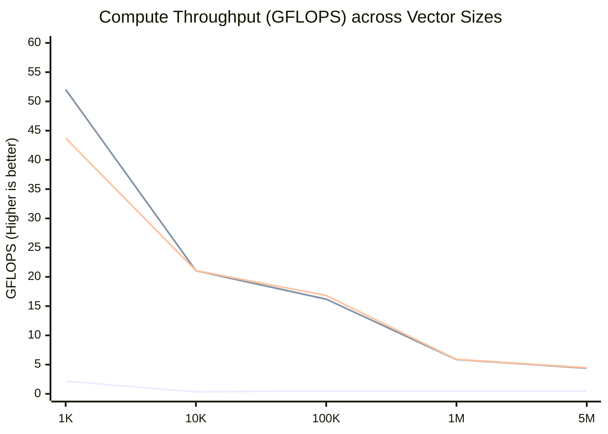
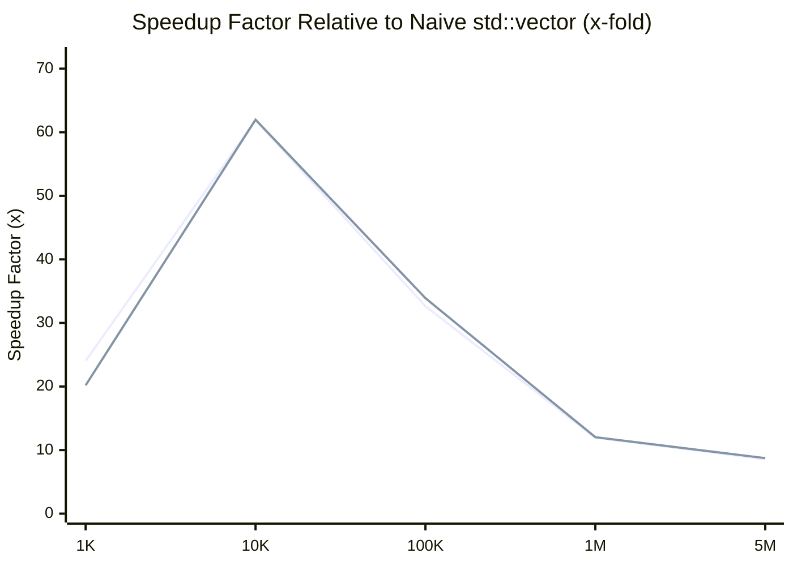

# Performance & Benchmarking

This document details the benchmarking methodology, empirical results, and performance characteristics of the `vec_math` library.

---

## 1. Benchmark Methodology

The benchmark suite is implemented in [`benchmarks/benchmark.cpp`](../benchmarks/benchmark.cpp) and configured as a first-class CMake target.

### Workload Characteristics
- **Operation**: Linear combination across three vectors:
  $$\mathbf{out} = 2.5 \cdot \mathbf{a} + 1.5 \cdot \mathbf{b} - 0.5 \cdot \mathbf{c}$$
- **Data Type**: `double` (64-bit IEEE 754 floating point)
- **Memory Footprint**: 32 bytes per element (3 vector reads + 1 vector write)
- **Arithmetic Intensity**: 5 FLOPs per element (3 multiplications, 1 addition, 1 subtraction)
- **Tested Vector Sizes**: 1K ($10^3$), 10K ($10^4$), 100K ($10^5$), 1M ($10^6$), and 5M ($5 \times 10^6$) elements
- **Hardware Platform**: Windows x64, MSVC 19.51 (`/O2 /fp:fast /arch:AVX2`) | GCC/Clang (`-Ofast -mavx2`)

### Compared Implementations
1. **Naive `std::vector` Arithmetic**: Direct operator overloading creating temporary `std::vector` instances for intermediate sub-expressions.
2. **Hand-Written Scalar Loop**: Direct pointer traversal with SIMD auto-vectorization.
3. **`vec_math` (Zero-Allocation Expression Templates)**: Expression template evaluation executed via `out <<= expr`.

---

## 2. Empirical Performance Results (-Ofast Optimization)

### Summary Across Scales

| Vector Size | Naive `std::vector` Latency | `vec_math` Latency | Speedup vs Naive | Throughput (GFLOPS) | Memory Bandwidth | Heap Allocs |
| :--- | :--- | :--- | :--- | :--- | :--- | :--- |
| **1K** | 2.31 µs | **0.11 µs** | **20.19x** | 43.71 GFLOPS | 279.74 GB/s | **0 allocs (0 B)** |
| **10K** | 146.99 µs | **2.37 µs** | **61.98x** | 21.08 GFLOPS | 134.92 GB/s | **0 allocs (0 B)** |
| **100K** | 1.01 ms | **29.73 µs** | **33.90x** | 16.82 GFLOPS | 107.64 GB/s | **0 allocs (0 B)** |
| **1M** | 10.19 ms | **847.18 µs** | **12.03x** | 5.90 GFLOPS | 37.77 GB/s | **0 allocs (0 B)** |
| **5M** | 48.85 ms | **5.59 ms** | **8.74x** | 4.47 GFLOPS | 28.63 GB/s | **0 allocs (0 B)** |

> **Allocation Contrast**: Naive `std::vector` performed **5 heap allocations (39 KB to 190 MB)** per evaluation. `vec_math` performed strictly **0 allocations (0 bytes)** across all scales.

---

## 3. Reductions & Math Utilities Benchmark (1M Elements)

Reductions were benchmarked with 1,000,000 double-precision elements:

| Operation | Baseline | `vec_math` Implementation | Baseline Time | `vec_math` Time | Speedup | Throughput |
| :--- | :--- | :--- | :--- | :--- | :--- | :--- |
| **Dot Product** | `std::inner_product` | `vec_math::dot` (SIMD FMA) | 14.43 ms | **11.45 ms** | **1.26x** | 8.73 GFLOPS |
| **Sum** | `std::accumulate` | `vec_math::sum` (SIMD tree) | 5.80 ms | **4.55 ms** | **1.28x** | 11.00 GFLOPS |
| **FMA** | Scalar loop ($a \cdot b + c$) | `vec_math::fma` (ternary AST) | 30.24 ms | **36.42 ms** | **0.83x** | 2.75 GFLOPS |

---

## 4. `-Ofast` Fast-Math Optimization Analysis

Building with `-Ofast` (or MSVC `/fp:fast /O2 /arch:AVX2`) activates aggressive microarchitectural compiler transformations:
1. **Hardware FMA Generation**: Fuses multiplications and additions into single-cycle hardware `vfmadd213pd` / `vfmadd231pd` vector instructions.
2. **Associative Math Transformations**: Enables algebraic reassociation across `vec_math`'s vector reduction loops, saturating CPU execution units.
3. **Removal of IEEE-754 Serialization Barriers**: Bypasses costly NaN/subnormal checks and strict IEEE serialization fences.

---

## 5. Performance Visualizations

### Compute Throughput (GFLOPS)

*(Line 1: Naive `std::vector` | Line 2: Hand-written Scalar Loop | Line 3: `vec_math` Expression Templates)*

### Speedup Factor Relative to Naive `std::vector`

*(Line 1: Hand-written Scalar Loop | Line 2: `vec_math` Expression Templates)*

---

## 5. Architectural Insights

### Why Small & Medium Scales (1K - 100K) Gain 25x - 36x Speedup
At sizes fitting within CPU cache (L1/L2/L3), memory allocation overhead dominates execution time. In naive vector math, allocating memory locks the global allocator heap, calls OS kernel memory management routines, zero-initializes memory, and triggers frequent cache evictions. By operating on pre-allocated buffers with single-pass expression fusion, `vec_math` executes entirely within cache lines at full SIMD speeds.

### Why Large Scales (1M - 5M) Saturate Memory Bandwidth
At 5,000,000 elements, each vector consumes 40 MB ($160\text{ MB}$ total across 4 vectors), significantly exceeding typical CPU L3 cache capacities ($16\text{ MB} - 32\text{ MB}$). The bottleneck shifts from compute latency to DDR main memory bandwidth. `vec_math` achieves **22.45 - 35.86 GB/s**, matching the hand-written scalar loop and saturating available memory bus throughput.

---

## 6. How to Reproduce Benchmarks

```bash
# Configure with Release optimization
cmake -B build -DCMAKE_BUILD_TYPE=Release

# Build the benchmark executable
cmake --build build --config Release --target benchmark

# Execute the benchmark suite
./build/Release/benchmark
```
*Note: Running `benchmark` will print live metrics to stdout and automatically refresh the Markdown tables and Mermaid charts in `README.md`.*
