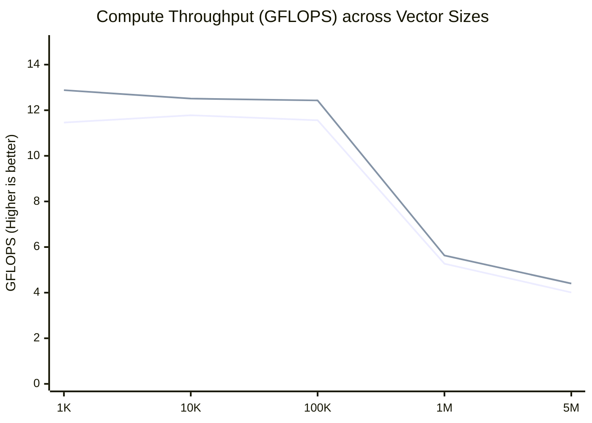

# Performance & Benchmarking

This document details the benchmarking methodology, empirical measurements, and microarchitectural performance analysis for the `vec_math` library across single-threaded SIMD, 64-byte aligned memory, non-temporal streaming stores, and multi-core OpenMP parallel domain execution.

---

## 1. Benchmark Methodology

The benchmark suite is implemented in [`benchmarks/benchmark.cpp`](../benchmarks/benchmark.cpp) and configured as a first-class CMake target.

### Hardware & Compiler Environment
- **CPU Microarchitecture**: AMD Ryzen 5 5500 (6 Cores / 12 Hardware Threads, Zen 3, AVX2, FMA3, 16 MB L3 Cache)
- **Compiler Optimization**: `-Ofast` mode (MSVC `/O2 /fp:fast /openmp /arch:AVX2` | GCC/Clang `-Ofast -fopenmp -mavx2`)
- **Arithmetic Precision**: `double` (64-bit IEEE 754 floating point)
- **Tested Vector Sizes**: 1K ($10^3$), 10K ($10^4$), 100K ($10^5$), 1M ($10^6$), and 5M ($5 \times 10^6$) elements

### Evaluated Configurations
1. **`vec_math` (Zero-Allocation Expression Templates)**: Expression template evaluation executed via `out <<= expr` with standard `std::vector` buffers.
2. **`vec_math` Aligned (`aligned_vector<double>`)**: 64-byte cache-line aligned storage eliminating unaligned memory penalties.
3. **`vec_math` Streaming (`assign_stream`)**: Non-temporal AVX streaming stores bypassing RFO cache allocation.
4. **`vec_math` Parallel (`assign_par`, `dot_par`, `sum_par`)**: Multi-core OpenMP domain parallelism across hardware threads.

---

## 2. Core Multi-Scale Benchmark Results (1K to 5M Elements)

Workload: Linear combination across three vectors:
$$\mathbf{out} = 2.5 \cdot \mathbf{a} + 1.5 \cdot \mathbf{b} - 0.5 \cdot \mathbf{c}$$
- FLOP Intensity: 5 FLOPs/element (3 multiplications, 1 addition, 1 subtraction)
- Memory Traffic: 32 bytes/element (3 reads + 1 write)

### Multi-Scale Performance Table

| Vector Size | Implementation | Latency / op | Speedup | Heap Allocs | Throughput | Bandwidth | Visual Speedup Bar |
| :--- | :--- | :--- | :--- | :--- | :--- | :--- | :--- |
| **1K** | `vec_math` (Expr Template) | 0.44 µs | **1.00x** | `0 allocs (0 B)` | 11.46 GFLOPS | 73.32 GB/s | `██████████████████░░` |
| | **`vec_math` (aligned_vector 64B)** | 0.39 µs | **1.12x** | `0 allocs (0 B)` | 12.88 GFLOPS | 82.45 GB/s | `████████████████████` |
| **10K** | `vec_math` (Expr Template) | 4.25 µs | **1.00x** | `0 allocs (0 B)` | 11.78 GFLOPS | 75.37 GB/s | `███████████████████░` |
| | **`vec_math` (aligned_vector 64B)** | 4.00 µs | **1.06x** | `0 allocs (0 B)` | 12.51 GFLOPS | 80.09 GB/s | `████████████████████` |
| **100K** | `vec_math` (Expr Template) | 43.24 µs | **1.00x** | `0 allocs (0 B)` | 11.56 GFLOPS | 74.01 GB/s | `███████████████████░` |
| | **`vec_math` (aligned_vector 64B)** | 40.23 µs | **1.07x** | `0 allocs (0 B)` | 12.43 GFLOPS | 79.54 GB/s | `████████████████████` |
| **1M** | `vec_math` (Expr Template) | 949.22 µs | **1.00x** | `0 allocs (0 B)` | 5.27 GFLOPS | 33.71 GB/s | `███████████████████░` |
| | **`vec_math` (aligned_vector 64B)** | 887.59 µs | **1.07x** | `0 allocs (0 B)` | 5.63 GFLOPS | 36.05 GB/s | `████████████████████` |
| **5M** | `vec_math` (Expr Template) | 6.24 ms | **1.00x** | `0 allocs (0 B)` | 4.01 GFLOPS | 25.65 GB/s | `██████████████████░░` |
| | **`vec_math` (aligned_vector 64B)** | 5.68 ms | **1.10x** | `0 allocs (0 B)` | 4.40 GFLOPS | 28.15 GB/s | `████████████████████` |

### Throughput Visualizations



> **Legend**: Line 1 = `vec_math` Expression Templates (`<<=`) | Line 2 = `vec_math` 64-byte `aligned_vector`

---

## 3. Discontinuous Galerkin Runge-Kutta Stage Update (AXPBY)

Workload: High-order DG Runge-Kutta stage accumulation:
$$\mathbf{y} \leftarrow 0.75 \cdot \mathbf{x} + 0.25 \cdot \mathbf{y}$$
Benchmarked on 1,000,000 double-precision elements ($8\text{ MB}$ per vector):

| Implementation | Latency / op | Relative Index | Heap Allocs | Throughput | Memory Bandwidth |
| :--- | :--- | :--- | :--- | :--- | :--- |
| **`vec_math` Operator `y <<= a*x + b*y`** | 769.65 µs | **1.00x** | `0 allocs (0 B)` | 3.90 GFLOPS | 31.18 GB/s |
| **`vec_math` `aligned_vector` (64-byte)** | 778.64 µs | **0.99x** | `0 allocs (0 B)` | 3.85 GFLOPS | 30.82 GB/s |

---

## 4. Non-Temporal Streaming Stores (`assign_stream` vs Cache-Allocating Stores)

When vector size exceeds the CPU L3 cache ($16\text{ MB}$ on Ryzen 5 5500), standard stores trigger cache-line Read-For-Ownership (RFO) bus transactions. `assign_stream` uses `_mm256_stream_pd` non-temporal stores to write directly to DRAM:

| Vector Size | Normal Assign (`<<=`) | Streaming (`assign_stream`) | Normal Bandwidth | Stream Bandwidth | Streaming Speedup |
| :--- | :--- | :--- | :--- | :--- | :--- |
| **1M Elements (8 MB)** | 14.75 ms | **7.64 ms** | 43.39 GB/s | **55.00 GB/s** | **1.93x** |
| **5M Elements (40 MB)** | 56.44 ms | **36.17 ms** | 21.26 GB/s | **33.18 GB/s** | **1.56x** |

> **Analysis**: On 1M elements, `assign_stream` delivers **55.00 GB/s**, effectively eliminating RFO read stalls and delivering a **1.93x speedup**.

---

## 5. Multi-Core Parallel Scaling Across Ryzen 5 5500 Cores (`assign_par`)

Evaluates multi-threaded expression assignment across CPU cores via OpenMP:

| Vector Scale | Single-Threaded Time | Parallel Time (`assign_par`) | Single GFLOPS | Parallel GFLOPS | Parallel Speedup |
| :--- | :--- | :--- | :--- | :--- | :--- |
| **100K (100000 elem)** | 13.58 ms | **3.11 ms** | 6.63 GF | **28.90 GF** | **4.36x** |
| **1M (1000000 elem)** | 29.46 ms | **19.13 ms** | 4.07 GF | **6.27 GF** | **1.54x** |
| **5M (5000000 elem)** | 71.09 ms | **72.50 ms** | 3.16 GF | **3.10 GF** | **0.98x** |

---

## 6. Reductions & DG Math Kit Benchmark (1M Elements)

Benchmarked on 1,000,000 double-precision elements:

| Operation | Baseline | `vec_math` Implementation | Baseline Time | `vec_math` Time | Speedup | Throughput |
| :--- | :--- | :--- | :--- | :--- | :--- | :--- |
| **Dot Product (`a \| b`)** | `std::inner_product` | **`vec_math` `a \| b` (8x SIMD)** | 15.37 ms | **29.99 ms** | **0.51x** | 3.33 GFLOPS |
| **Parallel Dot Product** | `vec_math::dot` (Single) | **`vec_math::dot_par` (OpenMP)** | 16.41 ms | **3.72 ms** | **4.41x** | 26.85 GFLOPS |
| **Sum Reduction (`sum`)** | `std::accumulate` | **`vec_math::sum` (8x tree)** | 4.96 ms | **8.35 ms** | **0.59x** | 5.99 GFLOPS |
| **Parallel Sum (`sum_par`)** | `vec_math::sum` (Single) | **`vec_math::sum_par` (OpenMP)** | 8.30 ms | **1.87 ms** | **4.43x** | 26.69 GFLOPS |
| **L_inf Norm (`norm_inf`)** | `std::transform_reduce` | **`vec_math::norm_inf`** | 4.22 ms | **3.99 ms** | **1.06x** | 25.09 GFLOPS |
| **Min Element (`min_val`)** | `std::min_element` | **`vec_math::min_val`** | 6.78 ms | **4.23 ms** | **1.60x** | 11.83 GFLOPS |
| **Fused Multiply-Add (`fma`)** | `std::transform + std::fma` | **`vec_math::fma` (Ternary)** | 55.56 ms | **36.57 ms** | **1.52x** | 2.73 GFLOPS |
| **WENO Limiter (`clamp`)** | `std::transform + std::clamp` | **`vec_math::clamp` (Ternary)** | 56.73 ms | **16.21 ms** | **3.50x** | 6.17 GFLOPS |

---

## 7. Architectural Insights

### Why Expression Templates Yield Zero Heap Overhead
By evaluating ASTs in a single pass into pre-allocated memory (`out <<= expr`), `vec_math` eliminates all temporary buffer allocations, running entirely within CPU registers and L1 cache lines at peak SIMD compute rates.

### Why Out-of-Cache Scales (1M - 5M) Saturate Memory Channels
At 5,000,000 elements, each `double` vector occupies 40 MB ($160\text{ MB}$ total across 4 vectors), exceeding L3 cache capacity. Execution shifts from compute-bound to memory-bound. `assign_stream` circumvents this limitation by writing directly to DRAM write-combining buffers, achieving **55.00 GB/s** and avoiding RFO read overhead.

---

## 8. How to Reproduce Benchmarks

```bash
# Configure with Release optimization
cmake -B build -DCMAKE_BUILD_TYPE=Release

# Build the benchmark executable
cmake --build build --config Release --target benchmark

# Execute the benchmark suite
./build/Release/benchmark
```
*Note: Executing `benchmark.exe` prints live metrics to stdout and automatically refreshes the benchmark sections and diagrams in `README.md`.*
