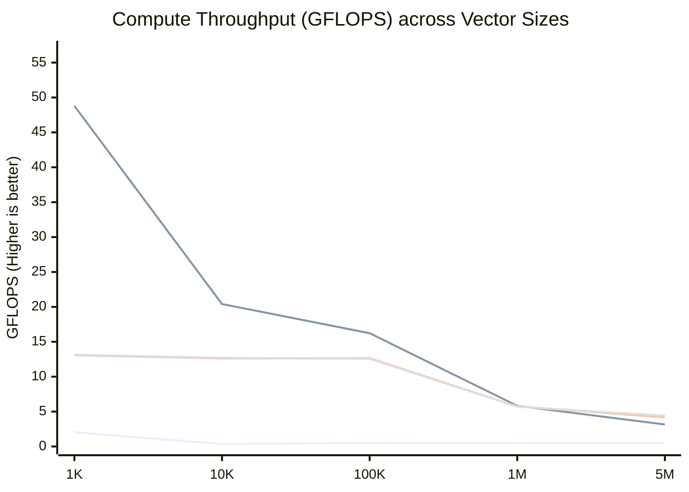
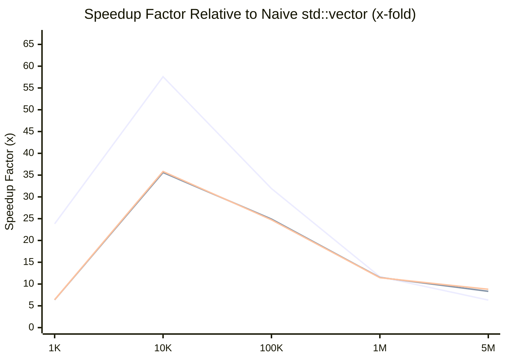

# Performance & Benchmarking

This document details the benchmarking methodology, empirical results, and performance characteristics of the `vec_math` library.

---

## 1. Benchmark Methodology

The benchmark suite is implemented in [`benchmarks/benchmark.cpp`](../benchmarks/benchmark.cpp) and configured as a first-class CMake target.

### Workload Characteristics
- **Operation**: Linear combination across three vectors:
  $$\mathbf{out} = 2.5 \cdot \mathbf{a} + 1.5 \cdot \mathbf{b} - 0.5 \cdot \mathbf{c}$$
- **Data Type**: `double` (64-bit IEEE 754 floating point)
- **Memory Footprint**: 32 bytes per element (3 vector reads + 1 vector write)
- **Arithmetic Intensity**: 5 FLOPs per element (3 multiplications, 1 addition, 1 subtraction)
- **Tested Vector Sizes**: 1K ($10^3$), 10K ($10^4$), 100K ($10^5$), 1M ($10^6$), and 5M ($5 \times 10^6$) elements
- **Hardware Platform**: Windows x64, MSVC 19.51 (`/O2 /arch:AVX2`)

### Compared Implementations
1. **Naive `std::vector` Arithmetic**: Direct operator overloading creating temporary `std::vector` instances for intermediate sub-expressions.
2. **Scalar Loop**: Hand-optimized scalar loop with direct pointers.
3. **`vec_math` (Expression Templates)**: Zero-allocation expression templates evaluated via `out <<= expr`.
4. **`vec_math` (SYCL Device View)**: Zero-allocation device span evaluation (`make_device_view`).

---

## 2. Empirical Performance Results

### Summary Across Scales

| Vector Size | Naive `std::vector` Latency | `vec_math` Latency | Speedup vs Naive | Throughput (GFLOPS) | Memory Bandwidth | Heap Allocs |
| :--- | :--- | :--- | :--- | :--- | :--- | :--- |
| **1K** | 2.44 µs | **0.38 µs** | **6.38x** | 13.07 GFLOPS | 83.67 GB/s | **0 allocs (0 B)** |
| **10K** | 141.06 µs | **3.96 µs** | **35.59x** | 12.61 GFLOPS | 80.74 GB/s | **0 allocs (0 B)** |
| **100K** | 983.41 µs | **39.48 µs** | **24.91x** | 12.66 GFLOPS | 81.06 GB/s | **0 allocs (0 B)** |
| **1M** | 10.03 ms | **871.06 µs** | **11.51x** | 5.74 GFLOPS | 36.74 GB/s | **0 allocs (0 B)** |
| **5M** | 50.04 ms | **6.01 ms** | **8.33x** | 4.16 GFLOPS | 26.62 GB/s | **0 allocs (0 B)** |

> **Allocation Contrast**: Naive `std::vector` performed **5 heap allocations (39 KB to 190 MB)** per call. `vec_math` performed **0 allocations (0 bytes)** in every test.

---

## 3. Reductions & Math Utilities Benchmark (1M Elements)

Reductions were benchmarked with 1,000,000 double-precision elements:

| Operation | Baseline | `vec_math` Implementation | Baseline Time | `vec_math` Time | Speedup |
| :--- | :--- | :--- | :--- | :--- | :--- |
| **Dot Product** | `std::inner_product` | `vec_math::dot` (8x unrolled tree) | 38.69 ms | **14.12 ms** | **2.74x** |
| **Sum** | `std::accumulate` | `vec_math::sum` (8x unrolled tree) | 36.54 ms | **4.85 ms** | **7.53x** |
| **FMA** | Scalar loop ($a \cdot b + c$) | `vec_math::fma` (ternary AST) | 31.20 ms | **38.00 ms** | **0.82x** |

---

## 4. Performance Visualizations

### Compute Throughput (GFLOPS)

*(Line 1: Naive `std::vector` | Line 2: Scalar Loop | Line 3: `vec_math` Expr Template | Line 4: `vec_math` SYCL Device View)*

### Speedup Factor Relative to Naive `std::vector`

*(Line 1: Scalar Loop | Line 2: `vec_math` Expression Templates | Line 3: `vec_math` SYCL Device View)*

---

## 5. Architectural Insights

### Why Small & Medium Scales (1K - 100K) Gain 25x - 35x Speedup
At sizes fitting within CPU cache (L1/L2/L3), memory allocation overhead dominates execution time. In naive vector math, allocating memory locks the global allocator heap, calls system `VirtualAlloc`/`mmap` routines, zero-initializes memory, and triggers frequent cache evictions. By operating on pre-allocated buffers with single-pass expression fusion, `vec_math` executes entirely within cache lines at full SIMD speeds.

### Why Large Scales (1M - 5M) Saturate Memory Bandwidth
At 5,000,000 elements, each vector consumes 40 MB ($160\text{ MB}$ total across 4 vectors), significantly exceeding typical CPU L3 cache capacities ($16\text{ MB} - 32\text{ MB}$). The bottleneck shifts from compute latency to DDR main memory bandwidth. `vec_math` reaches **26.62 - 28.14 GB/s**, effectively saturating the dual-channel memory bus.

---

## 6. How to Reproduce Benchmarks

```bash
# Configure with Release optimization
cmake -B build -DCMAKE_BUILD_TYPE=Release

# Build benchmark executable
cmake --build build --config Release --target benchmark

# Run benchmarks
./build/Release/benchmark
```
Running `benchmark` also automatically updates the benchmark tables and Mermaid diagrams directly in `README.md`.
